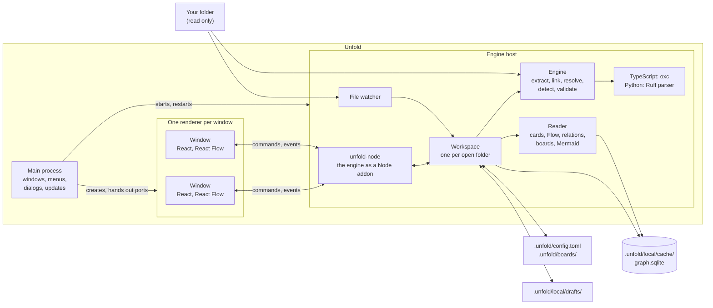

# Unfold architecture

Status: final architecture for V1 · 2026-10-08

This document describes what we are building in the new `unfold` repository and how it fits together. It replaces the two earlier proposals, `desktop-app-design.md` and `unfold-desktop-from-scratch.md`, which were compared, merged, and removed. Two companion documents complete it:

- [Decisions and trade-offs](decisions-and-tradeoffs.md) explains *why*: every decision (U-1 to U-37), the options we weighed, and the pros and cons of each.
- [Migration plan](migration-plan.md) explains *when*: the steps that migrate the proof of concept into Unfold and end with V1, and the V2 tracks after them.

The proof of concept is the `graph-compiler` repository, whose product was called "Codegraph". It stays as a frozen reference. No code moves over. Its semantics, test data, measurements, and reader design do.

## Summary

- **One desktop app.** You open a folder, press **Compile**, and read the code as a graph. You see entrances (routes, workers, schedules, commands, scripts), the functions they reach, and the calls between them, as cards on a board. There is no separate compiler, CLI, server, or web app.
- **A Rust engine in an Electron app, with a React UI.** TypeScript is parsed with oxc and Python with Ruff's parser. The engine is a native Node addon that runs in its own helper process, the engine host, so a crash in it never closes a window. Chromium renders the UI the same way on every platform.
- **As many windows as you want.** Several windows can show the same folder, each with its own boards, and they all share one engine and one graph. A board is open in one window at a time.
- **macOS, Windows, and Linux.** V1 ships on all three at once.
- **The graph keeps itself current.** After the first Compile, Unfold watches the folder and updates the graph in the background when files are saved. Only changed files are re-read and re-parsed, and only changed rows are written. V2 adds finer tracking, so that a typical edit re-resolves only its own file.
- **Every repository gets a `.unfold/` folder.** Shared things, the settings and published boards, sit at its top level and can be committed. Machine-only things, the graph cache and your drafts, sit in `.unfold/local/`, which Git ignores on its own.
- **The proof of concept's rules stay.** A call is linked only when there is proof of exactly one target. The graph records what the code declares, never what might happen at runtime. Code is shown only after its file's hash is checked. The same input produces the same graph. Nothing is ever run.
- **The proof of concept becomes the test oracle.** Its outputs are frozen, and Unfold must match them or record why it differs.

## 1. What Unfold is

### 1.1 The idea

A repository starts work through boundaries that a file tree doesn't show. A package script launches a process, `app.post("/orders", …)` registers handlers, a worker consumes a queue, a cron string schedules a job, and a console script names a Python callable. Unfold finds those boundaries without running anything, records what each one reaches, and lets a person read the path on a board.

The result is a graph of graphs. A repository is a graph of definitions connected by calls, constructions, imports, and passed callbacks. Each definition is itself a small structural graph of conditions, loops, and calls. A card shows one definition as its exact source (**Code**) or as a Mermaid-style diagram of its structure (**Flow**). An arrow leaves from the line that makes each call.

Unfold answers three questions, in this order:

| Question | Where in the app | Facts behind it |
| --- | --- | --- |
| What can start this project? | Entrances view | Declared entrances, their evidence, and their targets |
| Where is the implementation? | Files, Search, and cards | Definitions and their source ranges |
| What happens inside, and what does it depend on? | Code and Flow, arrows, inspector | Containment, slots, and the relationship recorded at each call |

### 1.2 A typical session

1. Open a folder with ⌘O, or drag it onto the window. The file tree appears at once.
2. Press **Compile**. Unfold reads the TypeScript and Python files, builds the graph, and creates `.unfold/`.
3. In **Entrances**, click `POST /orders`. A board opens with the entrance card and one card per handler.
4. Click the call to `orderService.place` inside `createOrder`. The `OrderService.place` card opens beside it, with an arrow from the calling line. Switch a card to Flow to see its structure.
5. Write a one-line description, label a Flow node, and group a few lines. The board saves itself as a draft.
6. Press ⇧⌘N for a second window on the same folder, and open a queue worker from **Entrances** there. Both windows follow the same graph.
7. Edit `order-service.ts` in your editor and save. The card updates within a second, in whichever window shows it.
8. Press **Publish**. The board is written to `.unfold/boards/order-placement.json`, ready to commit.

### 1.3 Non-goals

- Editing, refactoring, running, or debugging code, and language-server features such as completion. Unfold opens a file in your editor instead.
- Runtime traces, and control-flow or data-flow graphs.
- Accounts, hosted sharing, and real-time collaboration.
- Links between languages without explicit evidence, such as API contracts. Sharing one graph doesn't make a TypeScript client call a Python route.
- Entrances inferred from names, exports, or functions without callers.

## 2. Guarantees

| Guarantee | What it means | How we keep it |
| --- | --- | --- |
| Precision over recall | A call is `resolved` only with proof of exactly one target in the graph. Otherwise it is `external`, with its module, or `unresolved`, with one of 14 reasons. Nothing ever upgrades a guess. | The shared value policy ([§6.5](#65-the-shared-backend)). 100% precision gates against independent oracles ([§16](#16-testing)) |
| Static claims only | The graph records declarations, containment, and occurrences. An entrance is a declaration, not proof that it runs. Flow draws paths from written structure and marks what it can't route as opaque. | The graph model ([§5.5](#55-what-the-graph-does-not-claim)) and the Flow rules ([§10.4](#104-flow-view)) |
| Verified source | Code is shown only when the file's current bytes match the hash its facts came from. The graph stores ranges and hashes, never code. | Hash, then slice ([§10.6](#106-freshness)) |
| Deterministic | The same effective inputs give the same graph, whatever the thread count, the input order, or whether it was built at once or by many updates. | Canonical-export comparisons and incremental-equals-full property tests ([§16](#16-testing)) |
| Nothing runs | Unfold never executes the indexed code, installs dependencies, runs Git or package scripts, or needs Node or Python installed. The Node runtime inside Electron runs only Unfold's own code. | Execution-sentinel tests, packaged-app checks, and Electron fuses that stop the bundled runtime from running anything else ([§13](#13-security-and-privacy), [§16](#16-testing)) |
| One place in your folder | Unfold writes only inside `.unfold/` at the root of the opened folder. | Path confinement ([§13](#13-security-and-privacy)) |

## 3. Decisions at a glance

Each row links to its full reasoning in [Decisions and trade-offs](decisions-and-tradeoffs.md).

| Area | Decision | IDs |
| --- | --- | --- |
| Product | One desktop app, a reader rather than an editor, started fresh in a new repository | U-1, U-2, U-4 |
| Words | Unfold, Compile, Entrances, Board, Draft, Publish, Export, Code, Flow | U-3 |
| Engine | Rust | U-5 |
| Shell | Electron, with the Rust engine as a native addon (napi-rs) | U-6 |
| TypeScript | oxc's parser, semantic analysis, and resolver, with the proof of concept's native evidence rules and no type checker in V1 | U-7, U-8 |
| Python | Ruff's parser, pinned, with Unfold's own binder | U-9 |
| Engine shape | One shared backend behind narrow language adapters; the proof of concept's semantics, with its known defects fixed | U-10, U-11 |
| Offsets | UTF-8 bytes in the engine and UTF-16 at the UI boundary | U-12 |
| Compiling | Compile once, then update in the background. V1 caches per-file facts and relinks in memory; V2 adds early cutoff. | U-13, U-14 |
| Broken files | A file that stops parsing keeps its last good facts, and its code is withheld | U-15 |
| Scope and freshness | Discovery without Git, scope in settings, hash before showing, cheap checks first | U-16, U-17 |
| Repository footprint | `.unfold/` in every repository: shared `config.toml` and `boards/`, plus a self-ignored `local/` | U-18 |
| Graph storage | SQLite with write-ahead logging in `.unfold/local/cache/`, a cache rather than a contract | U-19, U-21 |
| Identity | Block IDs scoped to their file; structural keys for targets and boards | U-20 |
| Boards | `unfold-board` version 1. Drafts stay local, Publish writes to `.unfold/boards/`, and Export writes anywhere | U-22 |
| Settings | TOML in `.unfold/config.toml`, personal state in `.unfold/local/`, and app preferences in the OS | U-23 |
| UI | React. Rust computes, TypeScript lays out. IPC types are generated from Rust | U-24, U-25 |
| Window | Activity bar (Files, Entrances, Search, Boards), tabs, inspector, bottom panel, status bar | U-26, U-28, U-29, U-30 |
| Several windows | Any number of windows per folder, sharing one engine; a board is open in one window at a time | U-37 |
| Reader | The v7.1 reader rules carry over unchanged | U-27 |
| Processes | The main process, one engine host that runs the engine, and one sandboxed renderer per window | U-31 |
| Repository | A Cargo workspace of seven engine crates and the addon crate, and a pnpm workspace for the Electron app and the UI | U-32 |
| Testing | A frozen PoC reference with a divergence ledger, independent oracles, and incremental-equals-full tests | U-33, U-34 |
| Platforms | macOS, Windows, and Linux, all released in V1 and tested in CI from the first commit | U-35 |
| Build order | A vertical slice first, then the proof of concept migrated one part per step, behind spikes and gates | U-36 |

## 4. System overview

### 4.1 Processes



Unfold is an Electron app with three kinds of process ([U-31](decisions-and-tradeoffs.md#u-31-an-engine-host-and-locked-down-windows)):

- **The main process**, in TypeScript, owns the app's lifecycle: windows, menus, native dialogs, the single-instance lock, and updates. It does no graph work and never waits on the engine.
- **The engine host** is an Electron utility process. It loads `unfold-node`, the Rust engine compiled as a Node-API addon, and holds one workspace per open folder. Its JavaScript only routes messages between windows and the addon. If it stops, the main process restarts it and every window reconnects ([§11.2](#112-several-windows)).
- **Each window** is a sandboxed Chromium renderer running the React UI. It reaches the engine host over its own message port, and it can call only Unfold's commands ([§12](#12-commands-and-events), [§13](#13-security-and-privacy)).

### 4.2 Processes and threads

| Process | Thread | Work |
| --- | --- | --- |
| Each window | UI thread | React rendering, card layout, and input |
| Main process | Main thread | Windows, menus, dialogs, and updates |
| Engine host | JavaScript thread | Routes commands, results, and events between windows and the addon. It never blocks on long work: commands run on Rust threads and resolve as promises |
| Engine host | Engine thread, one per open folder | Owns the in-memory program for that folder and runs one compile or update at a time |
| Engine host | Rayon pool, shared | Parallel per-file extraction and resolution, with fewer threads and low priority for background updates |
| Engine host | Watcher thread | Debounces and batches file-system events |
| Engine host | SQLite | One writer per folder (its engine thread) and a pool of readers. Readers always see the last committed graph |

### 4.3 What happens during a compile

1. The workspace collects the changed paths. On the first Compile, that's every file in scope.
2. The engine reads and hashes those files. It takes their per-file facts from the cache, or extracts them in parallel.
3. It rebuilds the cross-file indexes in memory, resolves call sites, runs the entrance detectors, and validates the result.
4. It writes only the rows that changed, in one SQLite transaction.
5. It emits `graph_updated` with the changed files, keys, and entrances to every window that shows the folder. Each window refreshes only the cards that depend on them.

[Section 7](#7-compiling-and-keeping-the-graph-current) gives the details.

## 5. The graph model

### 5.1 Records

| Record | What it is |
| --- | --- |
| File | An indexed source file, with its language, its state, and the hash its facts came from |
| Block | A selected syntax entity: a function, class, call, `if`, loop, and so on. It has a byte range, a parent in the same file, a role relative to that parent, and a structural key |
| Slot | The range of a written part of a block, such as its condition, body, parameter *n*, or argument *n*, whether or not that part has a block of its own |
| Edge | A relationship sourced at one occurrence: a call, a construction, an import, or a named callable passed as an argument |
| Entrance | A declared way that a process or unit of work starts, with its evidence and ordered targets |
| Entrance target | One independently resolved handler or startup target |

Occurrences are the sources of edges, not functions. Function-level views, such as callers and owners, are derived ([§10.1](#101-derived-views)).

### 5.2 Vocabularies

These vocabularies carry over from the proof of concept unchanged.

**Block kinds**

| Kind | Meaning |
| --- | --- |
| `file` | An indexed source file's root |
| `function` | A function declaration or expression with a body, an arrow function, or a Python lambda |
| `class` | A non-ambient class declaration or expression |
| `method`, `constructor`, `getter`, `setter` | A class or object member with a body |
| `variable` | A non-ambient variable declaration, or one name bound by destructuring |
| `call`, `new` | A call or tagged template, and a construction (`new` is TypeScript only) |
| `import` | A runtime module dependency |
| `if` | A condition and its written branches. An `else if` is a nested `if` with role `else` |
| `for`, `for_in`, `for_of`, `while`, `do_while` | Loops. Python `for` maps to `for_of` |
| `switch`, `case`, `default` | A switch and its clauses. Python `match` cases are `case` blocks |
| `try`, `catch` | A try statement and its handlers. `finally` is a slot |
| `return`, `throw`, `break`, `continue` | Transfers. Python `raise` maps to `throw` |
| `expression_statement` | A standalone expression |
| `with`, `match` | Python only |

**Roles**: a block's relationship to its saved parent. The roles are `body`, `parameter`, `condition`, `then`, `else`, `initializer`, `update`, `iterable`, `catch`, `finally`, `expression`, `binding`, `callee`, `argument`, `heritage`, `decorator` (TypeScript), `header` (Python decorators, defaults, annotations, and class bases), `name`, or empty.

**Slots**

| Block kind | Slots |
| --- | --- |
| `function`, `method`, `constructor`, `getter`, `setter` | `name`, repeated `parameter`, `return_type`, `body` |
| `class` | `name`, `heritage` |
| `variable` | `name`, `initializer` |
| `call`, `new` | `callee`, repeated `argument` |
| `if` | `condition`, `then`, `else` |
| `for` | `initializer`, `condition`, `update`, `body` |
| `for_in`, `for_of` | `initializer`, `iterable`, `body`, and `else` in Python |
| `while`, `do_while` | `condition`, `body`, and `else` in Python |
| `switch` | `expression`, `body` |
| `case` | `condition`, `body` |
| `default` | `body` |
| `try` | `body`, `catch` (repeated and indexed in Python), `finally`, and `else` in Python |
| `catch` | `binding`, `body` |
| `with`, `match` | `expression`, `body` |
| `return`, `throw`, `expression_statement` | `expression` |
| `import` | `specifier` |

**Edges**

| Edge kind | Source | Resolved target kinds |
| --- | --- | --- |
| `calls` | `call` | `function`, `method`, `constructor`, `getter`, `setter`, `class` |
| `constructs` | TypeScript `new`, or a Python call with proven class identity | `function`, `method`, `constructor`, or a `class` with no direct constructor |
| `imports` | `import` | `file` |
| `references` | `call` or `new`, at an argument position | `function`, `method`, `class` |

Every call, construction, and runtime import has exactly one occurrence edge. References follow their occurrence and are emitted only for arguments that resolve to a specific callable or class.

**Resolutions**: `resolved` (one proven target in the graph), `external` (a proven origin outside the graph, with a module label), and `unresolved` (with a reason).

**Reasons**

| Reason | Meaning |
| --- | --- |
| `unknown_name` | No declaration exists for the name, and it isn't a known global |
| `unknown_receiver` | The type of the member's receiver is unknown |
| `parameter` | The called value comes from a parameter |
| `mutable_binding` | Writes to the binding or member prevent a stable target |
| `not_concrete` | There is no proven concrete body: an interface or type member, an abstract or ambient declaration, an overload with no implementation, or an opaque value |
| `accessor` | The call invokes an accessor's returned value, not the accessor itself |
| `ambiguous` | More than one body could be the target |
| `overridden` | Subclasses in the graph can supply different implementations |
| `unbound_this` | `this` inside a non-arrow function that isn't a member |
| `not_indexed` | The target exists in the folder but outside the indexed files, because it was excluded or failed to parse |
| `not_found` | A relative import, launch path, or locator names nothing |
| `dynamic` | There is no static shape, as with a computed key, a call result, or a non-literal path |
| `wrapper` | A call result, decorator, or partial supplies the callable without proving which body it is |
| `unsupported` | A recognized form that the supported syntax doesn't cover, such as a spread or a sandbox processor |

**Entrances**

| Kind | Trigger | Targets |
| --- | --- | --- |
| `process` | Script or bin name, or a declared trigger | Exactly one startup: a file root, or the callable named by a Python console script |
| `command` | Subcommand | One or more handlers |
| `http` | Route path plus method (`GET`, `HEAD`, `POST`, `PUT`, `PATCH`, `DELETE`, `OPTIONS`, `ALL`) | One or more handlers |
| `worker` | Queue or topic | One or more handlers |
| `schedule` | Schedule expression | One or more handlers |
| `event` | Event name | One or more handlers |

A trigger's status is `exact`, `partial`, or `unknown`. Targets keep their declaration order, which is not an execution order. An unresolved handler never removes its entrance. One definition can serve several entrances, and one entrance can name several handlers. [Section 6.6](#66-entrance-detectors) lists the detectors.

**Module labels.** A label names a package (`express`, `@scope/name`), a Node built-in (`node:fs`), `global`, or a repository-relative path for a TypeScript import of an unindexed file. Python labels use the top-level package name, `python:<stdlib-root>`, or `python:builtins`. When several origins are possible, the label is a sorted JSON array.

### 5.3 Text, ranges, and lines

- Each update reads a file's bytes once, hashes them with SHA-256, and decodes them strictly as UTF-8. Invalid UTF-8 fails the file. A byte-order mark is kept as U+FEFF, and line endings and Unicode normalization are preserved.
- Ranges inside the engine are UTF-8 byte offsets. They are zero-based, half-open, and token-exact: they exclude leading comments, indentation, and trailing whitespace. A file root spans the whole text.
- Lines are one-based. CR, LF, CRLF, U+2028, and U+2029 end a line, and CRLF counts once.
- The UI only ever receives UTF-16 offsets. One module in `unfold-core` converts between the two using a per-file index ([U-12](decisions-and-tradeoffs.md#u-12-utf-8-offsets-in-the-engine-utf-16-at-the-ui)).
- Python name identity uses NFKC normalization, but names and ranges keep the written spelling. A Python file that declares a non-UTF-8 encoding fails.
- Paths are relative to the folder, separated by `/`, case-preserving, and never escape the root.

### 5.4 Identity and keys

- Within one graph database, a block is identified by `(file_id, local_id)`. Local IDs are numbered in preorder within each file, so changing a file renumbers only that file.
- A **structural key** names a block in a way that survives most edits, and it is what boards and resolved targets refer to ([U-20](decisions-and-tradeoffs.md#u-20-identity-file-scoped-ids-and-structural-keys)). Keys carry over from the proof of concept:

| Key part | Derivation |
| --- | --- |
| File root | `path#` |
| Named step | `kind:name`, with reserved characters escaped and `[n]` for duplicate siblings |
| Unnamed step | `kind[n]`, the zero-based position among siblings of that kind |
| Nested block | The parent key, then `/step` |
| Entrance | `entrance:` plus a JSON array of detector, kind, method, trigger, and first target text, with `#n` for duplicates |

For example, `ts-playground/src/routes/orders.ts#function:createOrder/if[0]` is the first `if` in `createOrder`. Ordinal steps such as `if[0]` shift when code is inserted before them, so boards protect them with guards and signatures ([§9.1](#91-board-files)).

### 5.5 What the graph does not claim

- It contains no control-flow graph, data-flow graph, or runtime trace. Source order is an outline, not an execution order. In `save(convert(value))`, the outer call is written first, but `convert` runs first.
- Activation closures follow resolved relationships and include every written branch. They over-approximate, so the UI says "reached at least from".
- Fingerprints cover sources and the configuration that shaped the graph, not installed packages or runtime state.
- An export, a name, or a function without callers never becomes an entrance.

### 5.6 Where the complete semantics live

The proof of concept's `docs/format.md`, `docs/compiler.md`, and `docs/reader.md` hold every invariant, syntax mapping, detector bound, and derivation rule. In Step 1 of the migration they are rewritten for the new repository as `docs/graph-model.md`, `docs/languages/typescript.md`, `docs/languages/python.md`, `docs/entrances.md`, and `docs/reader.md`, using Unfold's names and byte offsets. Where this document summarizes a rule, those files are authoritative.

## 6. The engine

### 6.1 Pipeline

| Stage | Runs over | Cached | Produces |
| --- | --- | --- | --- |
| Discover | Changed paths (the whole folder on a first Compile) | No | The set of files in scope |
| Snapshot | Changed files | No | Bytes, hash, decoded text, and line index |
| Extract | Changed files, in parallel | Yes, by path, content hash, engine version, and settings hash | Per-file facts: blocks, slots, names, roles, local bindings, import and export declarations, class shapes, call sites, and registration candidates |
| Link | The whole program, in memory | Rebuilt from cached facts | Module graph, export tables, class families, override and mutation censuses, globals, the emit map, and project inputs |
| Resolve | Every call site (V1), or only affected files (V2) | No | Edges with resolution, reason, module, and position |
| Detect | All detectors | No | Entrances and their ordered targets |
| Validate | The new graph state | No | Invariants hold, or the update fails |
| Commit | Only the rows that changed | No | One SQLite transaction and a `graph_updated` event |

### 6.2 Language adapters

Language crates answer narrow questions. One shared backend owns the policy.

```rust
/// One source language. Extraction is per file and cached; linking sees the whole program.
pub trait Language: Send + Sync {
    fn id(&self) -> LanguageId;
    fn producer(&self) -> Producer;                         // name and version, stored with the graph
    fn owns(&self, path: &RepoPath, settings: &Settings) -> bool;
    fn settings_hash(&self, path: &RepoPath, settings: &Settings) -> SettingsHash;
    fn extract(&self, file: &Snapshot, settings: &Settings) -> Result<FileFacts, SourceFailure>;
    fn link<'a>(&'a self, files: &'a FactsSet, inputs: &'a ProjectInputs) -> Box<dyn Linked + 'a>;
    fn highlighter(&self) -> &dyn Highlighter;
}

/// What the shared backend asks about. Evidence can withhold a target, never invent one.
pub trait Linked {
    fn callee_evidence(&self, call: CallSite) -> CalleeEvidence;
    fn value_evidence(&self, value: ValueRef) -> ValueEvidence;
    fn module_dependencies(&self, file: FileId) -> &[ModuleDependency];
    fn module_exports(&self, file: FileId) -> &[Export];
    fn classes(&self) -> &ClassTable;
    fn detectors(&self) -> &[&dyn EntranceDetector];
}
```

`FileFacts` has two parts. One is a language-neutral graph mapping: blocks, slots, call sites, and their ranges. The other is a private payload that only the language crate reads and serializes. The backend never interprets language syntax. A tiny in-memory "alien" test language proves this in `unfold-engine`'s tests, as it did in the proof of concept.

### 6.3 TypeScript

- **Files.** `.ts`, `.tsx`, `.mts`, and `.cts`. Declaration files (`.d.ts`) never get blocks. JavaScript comes in V2.
- **Parsing.** `oxc_parser`, pinned to an exact version behind Unfold's own syntax adapter. A file with syntax errors is a failed file with a message. There is no editor-style error recovery.
- **Project configuration.** Each file uses its nearest `tsconfig.json`. That means JSONC, an `extends` chain that may reach into installed packages, `paths` and `baseUrl`, module detection, JSX mode, and target-dependent semantics for parameters and class fields. A configuration's file selectors never change what is graphed.
- **Binding.** This uses `oxc_semantic`'s scopes, symbols, and references, with Unfold's binding rules on top. Those rules cover `var`, `let`, and `const` scoping, parameter visibility, destructuring, merging namespaces and enums, static and instance member tables, private names, `this` (arrow functions inherit it), and merged overloads. If `oxc_semantic` disagrees with these rules, the proof of concept's binder is ported onto oxc's syntax tree instead ([U-7](decisions-and-tradeoffs.md#u-7-typescript-through-oxc-without-a-type-checker-in-v1)).
- **Evidence levels.** These carry over from the proof of concept's native front end:
  1. lexical functions, constant function, arrow, and class initializers, and immediately invoked functions;
  2. named, default, and namespace imports, re-exports, packages, and known globals;
  3. classes, `new`, `super`, `this`, static members, and inherited members;
  4. written class and library annotations, parameter properties, property chains, and declared return types.

  New in Unfold: members of constant object literals (`logger.info`), which fixes PoC defect C-2.
- **Override census.** A method on an instance is withheld as `overridden` when a subclass in the graph can override it.
- **Globals and library receivers.** Tables of known ECMAScript, DOM, and Node globals and library receiver types are generated from TypeScript's `lib` files at a pinned version. `cargo xtask gen-lib-tables` parses those files with oxc and checks in the output, along with its source version.
- **Modules.** `oxc_resolver` with each file's `tsconfig`, covering `paths`, `baseUrl`, package `exports`, and `.js`-to-`.ts` extension aliasing. A missing relative import is `not_found`. A bare package import is `external` without needing installed packages. Existing files outside scope, and files that failed, are `not_indexed`.
- **Runtime imports.** Import declarations, `export … from`, `import x = require(…)`, and dynamic `import()` with a literal argument. Type-only imports are erased. Empty named forms such as `import {} from "x"` are erased unless `verbatimModuleSyntax` is on, which fixes C-12.
- **Emit map.** This maps compiled output paths, such as `node dist/server.js`, back to their sources, using each configuration's `rootDir`, `outDir`, and extension rules. When `rootDir` isn't given, it defaults to the configuration's directory. An output that two sources can produce stays ambiguous. Emitted files never need to exist.

### 6.4 Python

- **Parsing.** `ruff_python_parser`, pinned to a Ruff release tag behind Unfold's adapter. The grammar version comes from project settings: 3.12, 3.13, or 3.14, defaulting to 3.14. Syntax that the selected version doesn't support fails the file.
- **Structure.** Calls stay `call` blocks; only proven class identity turns their edge into `constructs`. Lambdas are `function`, `raise` is `throw`, `except` and `except*` are `catch`, and both `for` and `async for` are `for_of`. Decorators, defaults, annotations, and class bases use the `header` role and belong to the enclosing scope. Comprehensions create scopes but not blocks.
- **Binding.** These rules are ported from the proof of concept and are not borrowed from another checker:
  - **Write census.** Definitions, imports, assignments (including augmented and deleting ones), `global` and `nonlocal`, loop, `with`, and `except` targets, destructuring, assignment expressions, comprehensions, and type-parameter scopes are all counted. Any competing write anywhere in the indexed scope invalidates a name's identity.
  - **Reflection** needs proven identity. A non-literal `getattr` is `dynamic` and `functools.partial` is `wrapper`. An unknown `setattr` or `delattr` invalidates the members it might affect. Proven `exec` and `eval` make dependent module identities `unsupported`.
  - **Classes.** C3 linearization requires known bases. A virtual call needs a single implementation across every possible receiver. `super()` must agree across linearizations, and class attribute lookup needs a proven metaclass. A direct concrete `__init__` is the construction target; otherwise the class itself is. A callable instance needs a proven `__call__`.
  - **Receivers.** The first parameter of an ordinary method or a proven `classmethod` is the receiver; a `staticmethod` has none. An attribute's receiver comes from a written annotation or from a single proven assignment in the constructor.
  - **Decorators** must all be on the allowlist for a body to stay concrete: `staticmethod`, `classmethod`, `functools.cache`, `functools.lru_cache`, `typing.final`, and `typing.override`. Each must be proven by identity, not by spelling.
  - **Imports.** These cover absolute and relative imports, package initializers, namespace packages, a literal `__all__`, aliases, and conditional alternatives, all resolved only inside the configured source roots. A runtime import is suppressed only by a proven `TYPE_CHECKING` guard. A named child import (`from pkg import child`) adds a dependency only when the attribute is proven absent. Local modules outside scope are `not_indexed`. External labels come from a pinned standard-library inventory or the top-level package name.
  - **Positions** are written ordinals, including receivers, keywords, and expansions. Matching ordinals never bind a caller's argument to a parameter.
- **Source roots.** These come from `[[python.project]]` in `.unfold/config.toml`. Without one, Unfold uses `src/` when the project uses a src layout, and otherwise the folder that holds `pyproject.toml`.
- **Isolation.** No Python interpreter, virtual environment, or installed package is involved, ever.

### 6.5 The shared backend

The backend owns block selection, roles, names, slots, the value policy, the order in which reasons are assigned, module labels, provenance, edges, entrance assembly, locators, and the launch-command grammar.

**Block selection** (the TypeScript mapping; Python has its own): a function, method, constructor, or accessor becomes a block only when it has a body. A class becomes a block only when it is non-ambient. Variables become blocks, including one binding block for each destructured name. Calls, `new` expressions, runtime imports, and control statements also become blocks. Types, overload signatures, ambient declarations, namespaces, and brace-only blocks never become blocks, but their runtime descendants are still visited.

**Roles** use the first child slot on the path that leaves the nearest saved ancestor. A path through a decorator gets `decorator`.

**Names** come from syntax, never from matching targets. An anonymous function gets the name of the variable, parameter, field, or property it initializes, or of the identifier it is assigned to, or `default`.

**Value policy**

| Context | Target |
| --- | --- |
| Call | A concrete callable body |
| Construction | A callable function or method, a class's explicit constructor with a body, or otherwise the class |
| Reference (a callable passed as an argument) | A concrete function, method, or class |
| Handler (an entrance target) | A concrete function or method, including an inline function. A class handler is `unsupported` |

**Reason order.** The shared evidence path applies these tests in this order, and the first one that matches decides the outcome:

| Order | Test | Outcome |
| --- | --- | --- |
| 1 | The language withholds (wrapper, dynamic, unsupported, not concrete) | That reason |
| 2 | The evidence is ambiguous | `ambiguous` |
| 3 | `this` is unbound | `unbound_this` |
| 4 | The import binding target is `not_found`, `not_indexed`, or ambiguous | That reason |
| 5 | The effective candidate is excluded, or is a repository file outside scope | `not_indexed` |
| 6 | A proven package-import root with no local contradiction | `external` |
| 7 | No effective candidates | `external` for external augmentations only; otherwise `unknown_name` for an identifier, `unknown_receiver` for a property access, or `dynamic` |
| 8 | Every candidate is external, or they mix indexed and external | `external`, or `ambiguous` if mixed |
| 9 | An indexed candidate without a declaration | `unknown_name` |
| 10 | More than one distinct concrete target | `ambiguous` |
| 11 | No target | `parameter`, then `mutable_binding`, then `accessor`, then `not_concrete` |
| 12 | Non-concrete evidence beside one target, other than compatible overloads | `ambiguous` |
| 13 | Override evidence, or a subclass override found by the census | `overridden` |
| 14 | A class handler, or an unsupported target kind | `unsupported` |
| 15 | One permitted target | `resolved` |

**Module labels** apply four rules; the first that matches wins:

1. The package an import is rooted in.
2. The origin of the receiver: `app.get` on `const app = express()` names `express`.
3. `global`, for an undeclared, unimported root such as `console` or `process`.
4. Declaration locations, normalized and sorted.

**Provenance** proves a narrow import lineage within three steps. Those steps can be a property access, an imported identifier from an external package, a constant initialized by a call or `new`, or a written annotation. Detectors use it to recognize framework objects, but it never makes a callee callable.

**Edges and labels.** The edges for each occurrence are written in block order. Named-argument references follow their call in argument order. Labels are short syntax: an identifier, `receiver.member`, `callee()` with no arguments, `[…]` for computed keys, or `(…)` for anything else. A label is at most 120 UTF-16 units and never splits a surrogate pair.

**Manual locators** follow the grammar `path`, `path#name`, `path#Owner.member`, `path#default`, or `path:line`. They are resolved against current declarations and exports on every compile.

**Launch-command grammar.** Package scripts are interpreted from their JSON text and never executed. The grammar covers:

- a POSIX shell subset: `&&` and `;` steps, quoting, `env` and `cross-env` assignments, and `cd`;
- script references: `npm run`, `npm --prefix … run`, `yarn`, `pnpm`, and `bun run`, nested up to eight levels with cycle detection;
- file launchers, each with the exact accepted and rejected options carried over from the proof of concept: `node`, `tsx`, `ts-node`, `ts-node-esm`, `nodemon`, and `bun`.

The last step decides the startup. `npm run build && node dist/server.js` starts `src/server.ts` through the emit map.

### 6.6 Entrance detectors

| ID | Language | Recognizes | Trigger | Evidence |
| --- | --- | --- | --- | --- |
| `manual` | Both | `[[entrance]]` declarations in `.unfold/config.toml` | Declared | The TOML table, with a pointer |
| `package.script` | TypeScript | A `package.json` script whose final step launches a module | Script name | The JSON member |
| `package.bin` | TypeScript | `package.json` `bin` entries | Command name | The JSON member |
| `express.route` | TypeScript | `get`, `head`, `post`, `put`, `patch`, `delete`, `options`, and `all` on a proven Express application or router, with mount prefixes composed up to five levels | Method and path | The route call |
| `bullmq.worker` | TypeScript | `new Worker(queue, processor)` from `bullmq` | Queue name | The construction |
| `node-cron.schedule` | TypeScript | `schedule(expression, handler)` from `node-cron` | Cron expression | The call |
| `pyproject.script` | Python | `[project.scripts]` entries of the form `module:callable` | Script name | The TOML assignment |
| `fastapi.route` | Python | `get`, `post`, `put`, `patch`, `delete`, `options`, and `head` on a proven `FastAPI` or `APIRouter`, with `include_router` prefixes up to five mounts and `Depends` lists | Method and path | The decorator or registration call |
| `celery.task` | Python | Parameterized `@app.task(...)` on a proven `Celery` instance | The literal `queue` | The factory or registration call |
| `apscheduler.job` | Python | APScheduler 3 `BlockingScheduler.add_job` with `CronTrigger.from_crontab` | The crontab string | The `add_job` call |

Every detector recognizes only what its provenance proves. Lookalike local names, wrappers, spreads, and dynamic values become explicit `unsupported`, `wrapper`, `dynamic`, or `unknown` outcomes, never guesses. New detectors need positive cases, decoys, alias and rebinding cases, evidence-range checks, and refusal cases ([U-34](decisions-and-tradeoffs.md#u-34-testing-at-every-layer)).

### 6.7 Validation

Every compile and update validates the new graph state before committing it. Validation checks:

- the vocabularies, and that ranges are inside their file and on token boundaries;
- that parents contain their children and the tree is in preorder;
- slot cardinality, and that call, `new`, and import blocks pair one-to-one with their occurrence edges;
- that references are in argument order, and that resolved targets exist with a permitted kind;
- that reasons and modules appear exactly where they should;
- entrance ordering, evidence ranges and pointers, and target cardinality;
- that no resolved edge crosses languages;
- that input fingerprints match.

Language crates also supply an independent census of call sites and token boundaries, so validation doesn't just trust the extractor. A failed validation fails the update, and the previous graph stays.

### 6.8 Determinism

Files are processed in path order. Blocks are in preorder within each file, edges follow their source block, and entrances sort by evidence path, start, end, detector, kind, method, and trigger. Parallel work is reassembled by input index, never by completion order. The canonical export ([§8.6](#86-canonical-export)) must be identical under shuffled input order, any thread count, and any sequence of updates that ends with the same file contents.

### 6.9 Defects from the proof of concept

| ID | Defect in the proof of concept | In Unfold |
| --- | --- | --- |
| C-1, C-3 | The checker-backed producer can use a computed key's symbol as a target, or lose a signature's placeholder | Gone, along with that producer |
| C-2 | The native producer misses members of constant object literals (25 playground calls) | A bounded rule for constant object literals |
| C-4 | An explicit `this` parameter shifts parameter positions | Positions skip it |
| C-5 | A launch into an existing unindexed file can report `not_found` | Extensions are probed before choosing between `not_found` and `not_indexed` |
| C-6 | A local `NodeJS.Process` parameter is labeled `global` | The root must be undeclared |
| C-12 | Empty `import {} from "x"` forms create a dependency | They are erased, as TypeScript's emit does |
| C-8, C-9 | Open questions: destructured bindings from literal dynamic imports, and property locators compared with calls | Decided with fixtures during the TypeScript migration (C-8 in Step 4, C-9 in Step 5), then recorded as decisions |

## 7. Compiling and keeping the graph current

### 7.1 Three actions

| Action | When | What it does |
| --- | --- | --- |
| **Compile** (the button, or ⇧⌘B) | The first time you open a folder, and whenever you want to be sure | Checks every file against the graph and brings everything up to date. The first Compile creates `.unfold/` and builds the graph from nothing |
| **Background updates** | Automatically after the first Compile. You can pause them per folder | Watches the folder and applies changes a moment after files are saved |
| **Rebuild from scratch** | Rarely, from the menu or command palette | Deletes `.unfold/local/cache/` and compiles everything again |

### 7.2 One code path

The engine has one entry point, `update(changes)`:

- A first Compile is an update in which every file is new.
- A background update contains the files the watcher reported.
- Rebuild from scratch is an update over every file with an empty cache.

Because they all share this code path, a graph built by many updates is the graph a fresh compile would build from the same effective inputs, and the tests check exactly that ([§16](#16-testing)).

### 7.3 What "recompile only what changed" means

The graph has two kinds of facts:

- **Per-file facts** depend only on one file's bytes and its language settings: blocks, slots, names, roles, local bindings, import and export declarations, class shapes, and call sites. They are cached by path, content hash, engine version, and settings hash. A file whose bytes haven't changed is never parsed again.
- **Cross-file facts** depend on many files at once. They include which file an import names, which declaration an export chain ends at, which subclasses override a method, whether any module reassigns a function, and how a router's mount prefix combines with a route path. Edges and entrances are cross-file facts.

So editing one file can change edges in files that weren't edited:

| An edit in one file | Changes elsewhere |
| --- | --- |
| Renaming `export function place` | Every call to `place` in other files |
| Adding `class PriorityOrders extends OrderService` with its own `place()`, in a new file | `orderService.place()` calls in other files become `overridden`, although those files never import the new one |
| In Python, writing `orders.place = traced(orders.place)` | `place` loses its proven identity everywhere |
| Changing a router's mount prefix in `server.ts` | The trigger path of routes declared in `routes/orders.ts` |
| Creating `src/lib/slack.ts` | Imports in other files that were `not_found` now resolve |

**V1.** Every update does this:

1. Re-read, hash, and extract only the changed files, using the cache for bytes it has seen before.
2. Rebuild the cross-file indexes in memory from every file's cached facts.
3. Re-resolve every call site and re-run the detectors, in memory and in parallel.
4. Compare the result with the previous state, and write only the rows that changed, in one transaction.
5. Report which files, keys, and entrances changed, so that only those cards refresh.

Steps 2 and 3 cover the whole program, but they run on compact in-memory facts, with no parsing and no I/O. We expect well under a second for repositories with a few thousand files; Step 5 of the migration measures this and Step 9 sets a hard limit ([migration plan](migration-plan.md)). Re-resolving everything makes V1 correct by construction, because there is no dependency bookkeeping to get wrong ([U-14](decisions-and-tradeoffs.md#u-14-what-gets-recompiled-per-file-facts-in-v1-early-cutoff-in-v2)).

### 7.4 V2: early cutoff

For very large repositories, V2 skips re-resolving files that an edit can't affect:

- Each file's facts split into two parts, each with its own hash. The **interface** is what other files can observe: exports, top-level declarations and whether they are concrete and stable, class shapes, module-level writes, and registrations that detectors can trace. The **body** is everything else.
- While resolving, the engine records what each file consulted: other files' interfaces, census entries (a class family's overrides, the writes to a module member), and lookups that found nothing.
- An update re-resolves three sets of files: the changed files, the files that consulted a changed interface or census entry, and the files whose failed lookups match a created or deleted path. Detectors re-run only where their evidence or provenance changed.
- Most edits are inside function bodies. Then only the edited file is re-resolved.

V2's early cutoff is turned on only when the incremental-equals-full property tests pass with it ([§16](#16-testing)). A query-based framework of the kind rust-analyzer uses (Salsa) is the step after that, and only if V2 isn't enough.

### 7.5 Triggers, batching, and cancellation

- `notify`, with a debouncer, watches the folder through the same ignore rules as discovery. It watches `.unfold/config.toml`, `.unfold/boards/`, and `.unfold/local/drafts/` for external edits, and never watches `.git/` or `.unfold/local/cache/`.
- Saves are batched. An update starts about 300 ms after the last change, so a branch switch that touches 500 files becomes one update.
- A newer change cancels an update that hasn't started committing. The changes merge and the update starts again. Commits are atomic: the UI sees the old graph or the new one, never half of either.
- Background updates run at low priority on a limited number of threads. An explicit Compile uses every core but one.
- If the watcher can't keep up, because of an event overflow, Linux inotify limits, or a network volume, Unfold falls back to a periodic scan and says so in the status bar.
- While background updates are paused, the status bar counts the files that changed since the last Compile.

### 7.6 Files that don't parse

| State | Meaning | In the graph | On its cards |
| --- | --- | --- | --- |
| Current | Its facts come from the bytes on disk | Normal | Code and Flow shown |
| Pending | It changed on disk and the update hasn't committed yet | The previous facts | The last verified render, dimmed, labeled "updating" |
| Last good | It changed and no longer parses | The facts from the last version that parsed | The last verified render, dimmed, labeled "doesn't parse right now", while the app stays open; after a restart, code is withheld |
| Failed | No version of it has parsed | Absent; calls into it are `not_indexed` | Withheld; Problems shows the error |

The first Compile never aborts because some files don't parse. It builds the graph from the files that do, marks it incomplete, and lists the rest in Problems. Read errors and invalid settings are reported the same way. An engine or validation error fails the update and keeps the previous graph.

The UI keeps a card's last verified render only in memory. It never applies old ranges to new bytes, and it never persists source ([U-15](decisions-and-tradeoffs.md#u-15-a-file-that-stops-parsing-keeps-its-last-good-facts)). Rebuild from scratch drops last-good facts along with the cache, so a file that doesn't parse at that moment becomes failed.

### 7.7 Settings and inputs

The inputs that shape the graph are fingerprinted:

- `.unfold/config.toml`;
- each `tsconfig.json` and its `extends` chain;
- the `package.json` files that the package detectors read;
- the `pyproject.toml` files that console scripts and Python project settings use.

When one changes, the files whose settings hash changed are extracted again, and linking runs again. For example, changing the Python grammar version touches every Python file.

### 7.8 Reopening a folder

The graph in SQLite is usable as soon as the folder opens, and the folder's windows come back with their tabs and layout ([§11.2](#112-several-windows)). In the background, Unfold compares each file's size and modification time with the stored values, hashes only the files that differ, and runs one update. It also loads the cached per-file facts to rebuild the in-memory program, so the next save updates quickly. When an app update has changed the engine version, the cache no longer matches and Unfold recompiles in the background. Boards are unaffected.

### 7.9 What the status bar says

```text
● Graph current · 84 files · TypeScript + Python
◌ Compiling · 12 of 84 files
◌ Updating · 2 files changed
● 1 file doesn't parse · showing its last version that parsed
● Background updates paused · 3 files changed since the last compile
▲ Compile failed · see Problems
```

Clicking it opens a menu with Compile, Rebuild from scratch, Pause background updates, and Show index log.

## 8. Storage

### 8.1 `.unfold/` in every repository

```text
<folder>/.unfold/
├── config.toml              # shared settings; written only when a setting differs from the defaults
├── boards/                  # published boards; commit them like code
│   └── order-placement.json
└── local/                   # this machine only; Git ignores it
    ├── .gitignore           # contains "*", so Git ignores this folder and this file
    ├── cache/               # disposable: safe to delete at any time
    │   ├── graph.sqlite     # the graph, the per-file facts, and the search index
    │   └── lock             # one copy of Unfold per folder
    ├── drafts/              # your unpublished boards; not disposable
    │   └── 7f3c2a….json
    └── state.json           # each window's position, tabs, and layout; whether background updates are on
```

- The first Compile in a folder creates `.unfold/`. Opening and browsing a folder writes nothing.
- After a first Compile with default settings, Git sees nothing new, because everything is under the self-ignored `local/`. `config.toml` and `boards/` appear as new files only when you change a setting or publish a board, which is exactly when you'd want to commit them.
- `.unfold/` is never indexed or searched.
- **Clear graph cache** deletes `local/cache/` only. Drafts and state survive.
- Opening a subfolder of a repository gives that subfolder its own `.unfold/`.
- A team that doesn't want shared files can add `.unfold/` to its own `.gitignore`. Published boards then simply stay on each machine.

### 8.2 Outside the folder

| What | macOS | Windows | Linux |
| --- | --- | --- | --- |
| Preferences: theme, keyboard, editor command, background defaults, thread limit | `~/Library/Application Support/Unfold/preferences.json` | `%APPDATA%\Unfold\preferences.json` | `~/.config/Unfold/preferences.json` |
| Recent folders, and the welcome window's position | `~/Library/Application Support/Unfold/` | `%APPDATA%\Unfold\` | `~/.config/Unfold/` |
| Logs | `~/Library/Logs/Unfold/` | `%APPDATA%\Unfold\logs\` | `~/.config/Unfold/logs/` |
| Fallback for folders Unfold can't write to | `~/Library/Caches/Unfold/folders/<hash of the path>/` | `%LOCALAPPDATA%\Unfold\folders\<hash>\` | `~/.cache/Unfold/folders/<hash>/` |

Electron keeps Chromium's own caches in the same app-data folder. The UI never uses browser storage: everything it remembers goes through Rust into the files above or into `.unfold/local/`.

If a folder is read-only, or sits on a network volume where SQLite's write-ahead log isn't safe, `local/` moves to the fallback location and the status bar says so. Publishing then needs a writable folder.

### 8.3 The graph database

```sql
-- .unfold/local/cache/graph.sqlite. A cache: rebuilt whenever the engine version changes.
PRAGMA journal_mode = WAL;

CREATE TABLE meta (key TEXT PRIMARY KEY, value TEXT NOT NULL);
-- schema_version, engine_version, producers (JSON), settings_hash, compiled_at, complete

CREATE TABLE files (
  id          INTEGER PRIMARY KEY,
  path        TEXT NOT NULL UNIQUE,     -- folder-relative, '/'-separated, case preserved
  language    TEXT NOT NULL,            -- 'typescript' | 'python'
  state       TEXT NOT NULL,            -- 'current' | 'last_good' | 'failed'
  facts_hash  BLOB,                     -- SHA-256 of the bytes the facts came from
  disk_hash   BLOB,                     -- SHA-256 of the bytes at the last check
  disk_mtime  INTEGER,
  disk_size   INTEGER,                  -- cheap change check before hashing
  failure     TEXT                      -- syntax or read error, with its position
);

CREATE TABLE inputs (                   -- configuration that shaped the graph
  path TEXT PRIMARY KEY,
  role TEXT NOT NULL,                   -- 'unfold-config' | 'tsconfig' | 'package' | 'pyproject'
  hash BLOB NOT NULL
);

CREATE TABLE keys (id INTEGER PRIMARY KEY, key TEXT NOT NULL UNIQUE);   -- interned structural keys

CREATE TABLE blocks (
  file_id INTEGER NOT NULL, local_id INTEGER NOT NULL,
  key_id INTEGER NOT NULL UNIQUE,
  parent_local_id INTEGER,
  kind TEXT NOT NULL, role TEXT, name TEXT,
  start_byte INTEGER NOT NULL, end_byte INTEGER NOT NULL,
  start_line INTEGER NOT NULL, end_line INTEGER NOT NULL,
  PRIMARY KEY (file_id, local_id)
) WITHOUT ROWID;

CREATE TABLE slots (
  file_id INTEGER NOT NULL, block_local_id INTEGER NOT NULL,
  slot TEXT NOT NULL, idx INTEGER NOT NULL DEFAULT -1,
  start_byte INTEGER NOT NULL, end_byte INTEGER NOT NULL,
  PRIMARY KEY (file_id, block_local_id, slot, idx)
) WITHOUT ROWID;

CREATE TABLE edges (
  file_id INTEGER NOT NULL, source_local_id INTEGER NOT NULL, seq INTEGER NOT NULL,
  kind TEXT NOT NULL,                   -- 'calls' | 'constructs' | 'imports' | 'references'
  target_key_id INTEGER,                -- only when resolved
  target_text TEXT NOT NULL,
  resolution TEXT NOT NULL,             -- 'resolved' | 'external' | 'unresolved'
  reason TEXT, module TEXT, position INTEGER,
  PRIMARY KEY (file_id, source_local_id, seq)
) WITHOUT ROWID;
CREATE INDEX edges_by_target ON edges (target_key_id);

CREATE TABLE entrances (
  id INTEGER PRIMARY KEY,
  key_id INTEGER NOT NULL UNIQUE,
  kind TEXT NOT NULL, label TEXT, method TEXT, trigger TEXT, trigger_status TEXT NOT NULL,
  detector TEXT NOT NULL,
  evidence_path TEXT NOT NULL,
  evidence_start_byte INTEGER NOT NULL, evidence_end_byte INTEGER NOT NULL,
  evidence_block_key_id INTEGER,        -- source evidence
  evidence_pointer TEXT                 -- configuration evidence: JSON or TOML pointer
);

CREATE TABLE entrance_targets (
  entrance_id INTEGER NOT NULL, position INTEGER NOT NULL,
  role TEXT NOT NULL,                   -- 'startup' | 'handler'
  target_key_id INTEGER, target_text TEXT NOT NULL,
  resolution TEXT NOT NULL, reason TEXT, module TEXT,
  PRIMARY KEY (entrance_id, position)
);

-- Reader projections, recomputed after each update.
CREATE TABLE definitions (key_id INTEGER PRIMARY KEY, file_id INTEGER, local_id INTEGER,
                          kind TEXT, qualified_name TEXT);
CREATE TABLE applications (id INTEGER PRIMARY KEY, startup_key_id INTEGER, name TEXT, language TEXT);
CREATE TABLE memberships (entrance_id INTEGER, application_id INTEGER,
                          PRIMARY KEY (entrance_id, application_id));

-- The per-file facts cache.
CREATE TABLE file_facts (
  path TEXT NOT NULL, hash BLOB NOT NULL, engine TEXT NOT NULL, settings_hash BLOB NOT NULL,
  facts BLOB NOT NULL,                  -- serialized FileFacts
  PRIMARY KEY (path, hash, engine, settings_hash)
) WITHOUT ROWID;

CREATE VIRTUAL TABLE search USING fts5(name, qualified_name, path, kind, key UNINDEXED);
```

- **Keys are interned.** A structural key keeps its ID for the life of the database, so edges into an unchanged definition stay valid when other code moves.
- **Byte offsets are stored**, and `unfold-reader` converts them to UTF-16 when it builds what the UI renders.
- **Reached-from is computed on demand**, from the activation closures, and cached in memory.

### 8.4 The per-file facts cache

The cache holds the serialized `FileFacts`, in a compact serde format (postcard), keyed as above. For each path it keeps the current entry and the last good one. Deserializing facts is much cheaper than parsing, so reopening a folder rebuilds the in-memory program quickly.

### 8.5 Search index

FTS5 finds candidate definitions, entrances, and files, and a fuzzy matcher (`nucleo`) ranks them. Text search reads files with ripgrep's libraries (`grep-searcher`, `grep-regex`) through the same ignore rules. It streams results and can be cancelled.

### 8.6 Canonical export

The canonical export is a deterministic JSON Lines form of the whole graph. Records are sorted by path, range, and kind, and refer to structural keys instead of numeric IDs. For example (the values are illustrative):

```text
{"t":"block","key":"src/routes/orders.ts#function:createOrder","kind":"function","role":"body","name":"createOrder","range":[512,1044],"lines":[25,35]}
{"t":"edge","source":"src/routes/orders.ts#function:createOrder/variable:order/call[0]","seq":0,"kind":"calls","target":"src/services/order-service.ts#class:OrderService/method:place","text":"orderService.place","resolution":"resolved"}
```

It is used for snapshots, parity with the proof of concept, determinism checks, and debugging. It keeps what the proof of concept's CSV files were good at, reviewable diffs, without making them the storage format.

### 8.7 Concurrency

- Write-ahead logging lets UI queries read the last committed graph while an update runs.
- Only the folder's engine thread writes.
- Unfold runs as a single copy per user. Launching it again, or opening a folder from another program, hands the request to the running copy.
- Inside that copy, any number of windows can show a folder. They share its workspace: one engine thread, one SQLite writer, and one in-memory program ([§11.2](#112-several-windows)).
- A board is open in one window at a time, so two windows never edit the same board.
- A lock file in `local/cache/` keeps a second copy of Unfold, such as a development build or another version, from opening the same folder. That copy says the folder is open elsewhere instead.
- Board and settings files edited outside the app, by a person, an agent, or a branch switch, are reloaded when the open board has no unsaved changes. Otherwise Unfold asks which version to keep.

## 9. Files we treat as contracts

| Contract | Who reads it | How it's versioned |
| --- | --- | --- |
| Board file (`unfold-board`) | Teammates' apps, agents, and code review | `format` and `version` fields, plus a JSON Schema. Unknown fields are rejected |
| `.unfold/config.toml` | Teammates' apps | A `version` key. Unknown keys are rejected, with line and column |
| Canonical export | Tests and parity tools | Changes only with an explained snapshot update |
| IPC types | The UI | Generated from Rust and checked at build time |
| Graph database | Nobody else | Not a contract. Rebuilt whenever the engine version changes |

### 9.1 Board files

```json
{
  "cards": [
    {
      "at": [0, 0],
      "id": "post-orders",
      "ref": { "entrance": "entrance:[\"express.route\",\"http\",\"POST\",\"/orders\",\"requireUser\"]" }
    },
    {
      "at": [280, 0],
      "description": {
        "author": "person:you",
        "signature": "sha256:…",
        "text": "Places the order now, or queues it when the client asks for an async reply."
      },
      "folded": true,
      "id": "create-order",
      "ref": { "block": "ts-playground/src/routes/orders.ts#function:createOrder" },
      "view": "flow"
    }
  ],
  "defaultView": "flow",
  "format": "unfold-board",
  "groups": [],
  "guards": {},
  "labels": {
    "ts-playground/src/routes/orders.ts#function:createOrder/if[0]": {
      "author": "person:you",
      "signature": "sha256:…",
      "text": "Did the client ask for an async reply?"
    }
  },
  "title": "Order placement",
  "version": 1
}
```

| Field | Meaning |
| --- | --- |
| `format`, `version` | Always `"unfold-board"` and `1` |
| `title`, `defaultView` | The board's title, and `"code"` or `"flow"` |
| `cards[]` | `id`; `ref`, which is exactly one of `block` or `entrance`, holding a structural key; `at`, the canvas position; optional `view`; `folded`, written only when true; optional `description` |
| `groups[]` | `id`, `card`, `title`, `members` (the keys of consecutive sibling statements), `collapsed`, and an optional `description` |
| `labels` | Flow-node labels, keyed by block key |
| `guards` | The kind, owner, and source signature saved for each reference, used to reconnect safely |

- A **description** or **label** has `text`, `author` (`person:<username>` or `agent:<name>`), and `signature`, which is `sha256:` followed by the hash of the exact selected source bytes. When the signature no longer matches, the description is marked outdated.
- A **group** is a run of consecutive sibling statements with the same parent and body role, inside one card. Groups never cross a body boundary, overlap, or nest.
- **Writing** validates the whole board, serializes it deterministically (sorted keys, two-space indentation, final newline), and replaces the file atomically.
- **Reconnecting** after an update reuses surviving keys. A missing reference stays as a placeholder. An ordinal reference whose code changed is held for review. Renames and moves need a manual repair, which board health offers.
- The **top Code/Flow switch**, code folds, and peeks are view state and never go into the file.

### 9.2 Project settings

```toml
# Unfold settings for this repository. Commit this file to share them.
version = 1
languages = ["typescript", "python"]     # optional; default: every supported language found

[scope]
include = []                              # optional; when set, only these folders or globs are graphed
exclude = ["**/generated/**"]

[detectors]
disabled = []                             # for example ["node-cron.schedule"]

[[python.project]]
root = "py-playground"
source_roots = ["src"]
version = "3.12"                          # "3.12", "3.13", or "3.14" (the default)

# Entrances the detectors can't see, such as CLI dispatch or a signal handler.
[[entrance]]
kind = "command"
trigger = "import"
handler = "ts-playground/src/jobs/import-orders.ts#importOrders"

[[entrance]]
kind = "command"
trigger = "report"
handler = "ts-playground/src/cli.ts:12"

[[entrance]]
kind = "event"
trigger = "SIGTERM"
handler = "ts-playground/src/server.ts#shutdown"
```

| Key | Meaning |
| --- | --- |
| `version` | Settings format version, currently `1` |
| `languages` | Limits the languages graphed |
| `scope.include`, `scope.exclude` | Glob patterns relative to the folder. The defaults always apply as well ([U-16](decisions-and-tradeoffs.md#u-16-discovery-and-scope-without-git)) |
| `detectors.disabled` | Detector IDs to turn off. `manual` can't be turned off |
| `python.project` | `root`, `source_roots`, and the grammar `version` of each Python project |
| `entrance` | `kind`; an optional `trigger` (an empty trigger is invalid); `method` for `http` only; an optional `label`; and either `handler` (one locator or a list) or, for `process`, `startup` |

The app edits this file only through validated changes, such as Exclude from graph, the manual entrance editor, and Python project settings, and it preserves comments and formatting.

## 10. The reader

### 10.1 Derived views

These are computed by `unfold-reader` from the stored graph. Nothing here adds facts.

- **Owner.** The function, class, or file whose activation an occurrence belongs to. Walk up from the occurrence:

  ```text
  owner(block):
    current := block
    while current has a parent:
      parent := current.parent
      if parent is file: return parent
      if parent is class and current.role is not header: return parent
      if parent is function-like and current.role is body or parameter: return parent
      current := parent
    return current
  ```

  Nested callbacks own their own calls. Decorators and Python header expressions belong to the enclosing scope.
- **Definition catalog.** Every function-like or class block that has a name, or is the target of a resolved edge or entrance. Qualified names prepend the enclosing classes and callables. An unnamed callback is labeled after its callee.
- **Activation closure.** Starting from the seed targets, it adds the targets of resolved calls, constructions, imports, and references, plus the classes a file or callable owns. A branch seed considers only occurrences inside that branch. External and unresolved edges stop it. It is shown as "reached at least from".
- **Applications and membership.** An application is a distinct resolved startup among process entrances: a file, or the callable named by a Python console script. A non-process entrance belongs to every application whose closure contains its anchor, which is the owner of its evidence, or otherwise its first resolved target.
- **Relations.** Callers are found by reversing resolved edges and mapping each occurrence to its owner. Outgoing calls are grouped as already on the board, resolved and openable, or external or unresolved. Reached-from lists the non-process entrances whose closures contain the selected definition.
- **External and unresolved text.** External calls show their module. Unresolved calls show a short reason: "receiver type unknown", "parameter", "mutable binding", "not a concrete function", and so on. A guess never replaces either.

### 10.2 Cards

- An **entrance card** shows the declared entrance, its evidence, and its targets in registration order, without numbers.
- A **block card** shows one definition, or another indexed block, in Code or Flow.
- Cards open full and size themselves to their content: 360–880 px wide, with longer lines soft-wrapping. Nothing scrolls inside a card; you pan and zoom the canvas instead.
- Opening an entrance adds its card and a full card for each resolved handler. Following a call opens the target 80 px to the right, with its header level with the calling line, or focuses the card if it is already open.
- Each opened call has its own arrow, leaving from a port at the end of the calling line, even when several calls go to one card.
- A card folds to its title only when you fold it. Its arrows then attach to the header. Following a call into a folded card unfolds it.

### 10.3 Code view

- The exact verified slice of the source, with syntax colors.
- Each language crate computes highlighting in Rust. Python's comes from the parser's token stream. TypeScript's comes from oxc's lexer, or, if its token API isn't usable, from AST spans and comments plus a small keyword pass. The UI receives UTF-16 spans.
- Compound blocks (`if`/`else` chains, loops, `try`/`catch`, `switch`, callbacks, and Python `with` and `match`) are tinted, get an indent guide, and fold from the gutter. Python folds keep their written header. In a card longer than about 40 lines, callbacks and `else if` chains of three or more checks start folded.
- Calls are links at their written ranges:
  - hover to see the signature and location;
  - click to follow;
  - ⌥-click to expand the callee inline.

  External calls show their module, and unresolved calls have a dashed underline that explains why.
- Drag down the line-number gutter to make a group, then type its title on the magenta rail.

### 10.4 Flow view

Flow is labeled **Paths from written structure**. It is derived from saved blocks, roles, slots, and source order, never by re-parsing the source.

| Saved structure | Drawn as |
| --- | --- |
| Callable body | Start, the written statements, and End where a route reaches it |
| Statement, variable, call, construction | One node with its call chips. A main call can set the node's type |
| `if` and `else if` | A condition with yes and no lanes. A chain of three or more checks folds into one node with a "▸ N checks" tag |
| Loop | A header and body, with each, next, and done routes. A do-while tests after its body |
| `return`, `throw` | A terminal node. A return connects to End |
| Unlabeled `break` or `continue` | A transfer to the enclosing loop |
| TypeScript `try`/`catch` without `finally` | Separate regions with an on-error connection |
| Nested callback or class | A separate definition. The node lists it and it opens as its own card |
| TypeScript `switch` and `try`/`finally`; Python `with`, `match`, loops with `else`, and every `try`/`except` | An opaque region with a warning and no outgoing execution route |

Each node shows its compiler-derived type and a plain-language label, never raw code. The label is the board's authored label for that block. Without one, it falls back to a name taken from the code (a callee, a binding, or the names in a condition), drawn with a dotted underline, so you can see what still needs describing. Mermaid export uses the same labels as the app ([U-27](decisions-and-tradeoffs.md#u-27-the-reader-keeps-the-v71-rules)).

Flow is not a runtime trace or proof that a branch runs. Short-circuit expressions stay as written, labeled transfers get no guessed destination, and exceptions and asynchronous behavior aren't modeled.

### 10.5 Boards

- **Drafts.** Every board saves itself from its first card, a moment after each change, to `.unfold/local/drafts/`. Each window's open boards reopen with the folder.
- **Publish.** This shows the file it will write, `.unfold/boards/<slug-of-title>.json`, and never overwrites an existing one; the name is editable only when a file already has it. The board is validated, written, and its draft removed. After that, edits save into the published file, so `git diff` shows them. Unfold never runs Git.
- **Move back to drafts** reverses Publish. **Delete** asks first.
- **Export** writes Mermaid to a location you choose. SVG, PNG, and a Markdown walkthrough come in V2. Mermaid uses solid arrows for calls and constructions and dashed arrows for imports and passed references.
- **Health** lists missing references, outdated descriptions, broken groups, and guarded references that need review, and offers repairs.
- **Agents** can read and write board files directly, just like people. The app validates a board file when it loads it and reloads it when the file changes. A description an agent writes is attributed `agent:<name>`. The graph database is not an interface for agents. A stable agent interface comes in V2.

### 10.6 Freshness

| What the file check finds | What the reader does |
| --- | --- |
| The source matches the facts' hash | Code and supported Flow are shown |
| The source changed (pending or last good) | Names and relationships stay navigable. The last verified render stays dimmed in memory, and old ranges are never applied to new bytes |
| The source is missing or unreadable | The metadata is kept and the card shows that the source is unavailable |
| Configuration evidence changed | The old evidence range and the membership claims that depend on it are withheld |
| Another file is unchanged | That file stays readable on its own |

Before any range is shown, the file's bytes are read, hashed, and compared with the stored hash. Only then are those same bytes decoded and sliced.

### 10.7 Reader rules

These come from the v7.1 reader and from review comments on the Paper designs. They hold in every view:

- Cards size to their content and never scroll inside. Every opened function is a full card with its own Code/Flow switch.
- Calls in the code are the links, and an arrow leaves from the calling line. There is no per-card footer and no list of call chips.
- Code shows exact verified source with IDE syntax colors and folds from the compiled structure.
- There are no step numbers (1, 2, 2.1…) in any view.
- Flow looks like a Mermaid diagram. Each node shows its block type and a plain-language label, never raw code.
- A description is one quiet line with a **more** link. There are no heavy panels.
- A card folds to its title only when you fold it. Unfold never collapses anything by itself.
- Zoom is a camera and never changes what a card shows. Fit always shows the whole board.
- Nothing overlays the canvas: no overview screen and no minimap.
- The top Code/Flow switch is a lens and never edits the board. A card's own switch is saved with the board.
- The inspector is closed by default and never shows code.
- The colors are the Paper v7 tokens: an indigo accent (`#5862C0`), magenta for authored text, and the v7 syntax palette, in light and dark sets.

## 11. The desktop app

### 11.1 The window

`F`, `E`, `S`, and `B` are the activity bar icons: Files, Entrances, Search, and Boards. `→4` means four entrances are registered in that file, and `●` means the item is on the open board.

```text
┌──────────────────────────────────────────────────────────────────────────────────────────────────┐
│ orders-service ▾   Order placement · Draft       [ Code | Flow ]        Compile   Publish   ◨   ⋯ │
├───┬───────────────────────────┬───────────────────────────────────────────────┬──────────────────┤
│ F │ FILES                 ... │  Order placement ×   orders.ts ×              │ INSPECTOR        │
│ E │ ▾ orders-service          │                                               │                  │
│ S │   ▾ ts-playground/src     │  ┌──────────────┐    ┌───────────────────┐    │ createOrder      │
│ B │     ▸ db                  │  │ HTTP  POST   │    │ ƒ requireUser     │    │ orders.ts:25     │
│   │     ▸ jobs                │  │ /orders      │───▶│  if (!req.header( │    │                  │
│   │     ▾ routes              │  │              │    └───────────────────┘    │ Places the order,│
│   │         admin.ts      →1  │  │ requireUser  │    ┌───────────────────┐    │ or queues it.    │
│   │       ▾ orders.ts     →4  │  │ validateBody │───▶│ ƒ createOrder     │    │                  │
│   │           ƒ listOrders    │  │ createOrder  │    │  const draft = …  │    │ Calls            │
│   │           ƒ createOrder ● │  └──────────────┘    │  if (req.header(  │    │  ● place         │
│   │           ƒ cancelOrder   │                      └───────────────────┘    │  + slack.post    │
│   │     ▸ services            │                                               │  bullmq · add    │
│   │   ▸ py-playground         │  ← Back  POST /orders › createOrder  − + Fit  │ Reached from     │
│   │                           │                                               │  POST /orders    │
├───┴───────────────────────────┴───────────────────────────────────────────────┴──────────────────┤
│ PROBLEMS 2    INDEX LOG    REFERENCES                                                          ˅ │
│ ! services/payment.ts:42 doesn't parse · showing its last version   ! 2 descriptions outdated    │
├──────────────────────────────────────────────────────────────────────────────────────────────────┤
│ ● Graph current · 84 files · TypeScript + Python                          ! 2                92% │
└──────────────────────────────────────────────────────────────────────────────────────────────────┘
```

- **Title bar.** It holds:
  - the folder switcher with recent folders;
  - the board title (click to rename) with a Draft chip or the published path;
  - the Code/Flow lens;
  - **Compile**, quiet while the graph is current and showing progress while compiling;
  - **Publish**, the inspector toggle, and the board menu (Rename, Export Mermaid, Fold all, Unfold all, Move back to drafts, Delete).
- **Activity bar and sidebar.** One view at a time ([§11.3](#113-sidebar-views)).
- **Editor area.** Tabs for boards and source files ([§11.4](#114-tabs-boards-and-source-files)). A board tab can move into a window of its own ([§11.2](#112-several-windows)).
- **Inspector, bottom panel, and status bar.** See [§11.5](#115-inspector-bottom-panel-and-status-bar).

### 11.2 Several windows

You can open as many windows as you want, and put boards side by side on as many screens as you have ([U-37](decisions-and-tradeoffs.md#u-37-several-windows-per-folder-one-window-per-board)).

- **A window shows one folder.** ⇧⌘N opens another window on the same folder. **Open Folder in New Window**, in the folder switcher, opens a different folder beside it. Each window has its own tabs, sidebar, inspector, bottom panel, lens, and selection.
- **Windows on one folder share it.** They share one workspace: one engine, one graph, one watcher, and one SQLite writer. A save updates the cards in every window that shows them, and every window's status bar shows the same graph state.
- **A board is open in one window at a time.** Opening a board that another window has open focuses that window and its tab. **Move to New Window**, in the tab's menu and the command palette, moves a board, with its undo history, into a window of its own.
- **Source tabs can be open anywhere**, in any number of windows, because they are read-only.
- **Windows come back.** `.unfold/local/state.json` records each window's position, size, tabs, and layout. Reopening the folder restores every window, moved onto a visible screen if a display has gone.
- **Closing windows.** Closing the last window of a folder saves its drafts and closes its workspace. On macOS, Unfold keeps running with no windows, as Mac apps do. On Windows and Linux, closing the last window quits.
- **If the engine host stops.** Every window keeps its boards and shows "Reconnecting…" in the status bar. The main process restarts the engine host, which reopens each folder from its cache ([§7.8](#78-reopening-a-folder)), and the windows reconnect. Unsaved board edits stay in their window and are saved once it reconnects.
- **What a window costs.** Each window is its own Chromium renderer, so each adds memory ([§17](#17-performance-targets)). The graph is never copied into a window: each one fetches only the cards and pages it shows.

### 11.3 Sidebar views

**Files**

```text
FILES                             ⊟  ...
▾ orders-service
  ▸ .unfold              shared settings
  ▾ ts-playground
    ▾ src
      ▸ db
      ▸ jobs
      ▸ lib
      ▾ queues
          email-worker.ts             →1
          orders-worker.ts            →1
          queues.ts
          report-worker.ts            →1
      ▾ routes
          admin.ts                    →1
          health.ts                   →1
          middleware.ts
        ▾ orders.ts                   →4
            ƒ listOrders
            ƒ getOrder
            ƒ createOrder              ●
            ƒ cancelOrder
      ▸ services
        cli.ts
        scheduler.ts                  →2
        server.ts                     →2
        worker.ts
    ▸ scripts                not indexed
      package.json            7 launches
  ▸ py-playground
  ▸ node_modules                 ignored
```

- The tree shows the folder as it is on disk, honoring ignore rules. Ignored folders are dimmed, or hidden with a toggle.
- Expanding an indexed file shows its definitions in source order, with classes holding their methods. This outline replaces the proof of concept's flat Definitions list.
- Quiet marks on the right show:
  - `→N` for entrances registered in the file;
  - `●` for items on the open board;
  - an amber dot for a changed or pending file;
  - a warning for a file that doesn't parse;
  - "not indexed" for unsupported languages;
  - "N launches" on `package.json` and `pyproject.toml`.
- Clicking a definition opens or focuses its card, and double-clicking a file opens a source tab. The context menu offers Open card, Open source, Open in editor, Show callers, Exclude from graph, Include in graph, Graph only this folder, and Reveal in Finder (Show in Explorer on Windows, and Show in file manager on Linux).

**Entrances**

```text
ENTRANCES                                  ...
▾ server        ts · src/server.ts           9
    npm run start · npm run dev
    GET     /health
    GET     path unknown
    GET     /admin/stats
    GET     /orders
    GET     /orders/:id
    POST    /orders                          ●
    DELETE  /orders/:id
    GET     /health/live
    EVENT   SIGTERM
▸ server        py · orders_playground.server:main
    orders-api · orders-api-dev
▸ worker        ts · src/worker.ts           3
▸ scheduler     ts · src/scheduler.ts        2
▸ cli           ts · src/cli.ts              4
▸ Not reached from a launch                  0
▸ Launches into code that isn't indexed      1
```

- Applications are named after their startup, with their launches underneath, followed by their entrances and a fixed method column.
- A language tag helps in mixed repositories.
- Clicking an entrance opens its card and its handler cards.

**Search**

```text
SEARCH
┌──────────────────────────────────────────────────┐
│ place                                            │
└──────────────────────────────────────────────────┘
 All · Definitions · Entrances · Files · Text

DEFINITIONS · 2
  ƒ OrderService.place  services/order-service.ts:13
  ƒ OrderService.place  services/order_service.py:20
ENTRANCES · 2
  POST /orders                   routes/orders.ts
  POST /orders                   routes/orders.py
TEXT · 12 matches in 5 files
  routes/orders.ts
    32  const order = orderService.place(draft);
```

- One field, with results grouped by kind and tabs to narrow them.
- ⌘P (files) and ⌘T (symbols) open the same search as a quick-open overlay.
- Definitions and entrances open cards. Files and text matches open source tabs.

**Boards**

```text
BOARDS                                 +
  ■ Order placement                    5
  ■ Worker retries            2 outdated
DRAFTS · on this machine
  □ POST /orders                       3

ON THIS BOARD                          ⊟
  POST /orders
    requireUser
    validateBody
    createOrder                        ●
      OrderService.place
        validateOrder
GROUPS
  Queue or place now         createOrder
```

- Published boards have a filled square and drafts an open one. A label appears only when something is wrong.
- The outline of the open board lists its cards in follow order, indented by call depth, then its groups. "N Flow nodes still show code names" steps through unlabeled nodes.

### 11.4 Tabs: boards and source files

A board tab is a canvas. A source tab shows a whole file, read-only, drawn by the same renderer as Code cards, with syntax colors, folds, and calls as links. A `⊕` in the gutter beside each definition adds it to the open board, and `●` marks what's already there. Long files are virtualized by line.

```text
┌──────────────────────────────────────────────────────────────────────────────────────────┐
│ ts-playground/src/routes/orders.ts                      ● on board   Graph current   ... │
├──────────────────────────────────────────────────────────────────────────────────────────┤
│ 25  ⊕  export async function createOrder(req: Request, res: Response): Promise<void> {   │
│ 26       const draft: OrderDraft = req.body;                                             │
│ 27  ▾    if (req.header("prefer") === "respond-async") {                                 │
│ 28         const job = await ordersQueue.add("place-order", { order: draft });           │
│ 29         res.status(202).json({ jobId: job.id });                                      │
│ 30         return;                                                                       │
│ 31       }                                                                               │
│ 32       const order = orderService.place(draft);                                        │
│ 33       slack.post("#orders", `Order ${order.id} placed for ${order.customerId}`);      │
│ 34       res.status(201).json(order);                                                    │
│ 35     }                                                                                 │
└──────────────────────────────────────────────────────────────────────────────────────────┘
```

A source tab may show current text that hasn't been compiled yet. It is labeled as such, and no graph links are drawn on it until the update commits.

### 11.5 Inspector, bottom panel, and status bar

- **Inspector (right).** Closed by default (toggle with `]` or ⌥⌘B), and it never shows code.
  - With a card selected, it edits the card's description and lists its Calls (on the board, **+ Open**, or external with a module), Called by, Reached from, and Groups.
  - With a Flow node selected, it shows the node's type and lines, edits its Flow label (showing the code-name fallback it replaces), and shows its yes and no paths.
  - Every edit is signed with you as the author.
- **Bottom panel.**
  - **Problems** lists files that don't parse or can't be read, settings errors, unsupported grammar versions, ambiguous Python module roots, and board health. Unresolved calls are not problems ([U-28](decisions-and-tradeoffs.md#u-28-problems-lists-only-real-problems)).
  - **Index log** shows the last compile: files read, taken from cache, or failed, the time per stage, and counts by resolution, reason, entrance kind, and detector.
  - **References** shows callers and reached-from as trees.
- **Status bar.** Graph state ([§7.9](#79-what-the-status-bar-says)), languages, problem count, and zoom.

### 11.6 Welcome and the first Compile

With no folder open:

```text
┌────────────────────────────────────────────────────────────────────────┐
│                                                                        │
│                                 unfold                                 │
│            See how a codebase starts, and follow where it goes.        │
│                                                                        │
│                       [  Open Folder…   ⌘O  ]                          │
│                                                                        │
│   Recent                                                               │
│     orders-service      ~/code/orders-service          2 hours ago     │
│     graph-compiler      ~/Desktop/repos/graph-compiler   yesterday     │
│                                                                        │
└────────────────────────────────────────────────────────────────────────┘
```

After opening a folder that has never been compiled:

```text
┌────────────────────────────────────────────────────────────────────────┐
│                                                                        │
│   orders-service                                                       │
│   34 TypeScript files and 50 Python files.                             │
│   Skipped: node_modules, .venv, dist (from .gitignore and defaults).   │
│   [ Choose folders… ]                                                  │
│                                                                        │
│   [  Compile  ]                                                        │
│                                                                        │
│   Reads files only. Runs nothing and installs nothing.                 │
│   Creates .unfold/ in this folder for the graph and your boards.       │
│   After this, the graph updates itself as files change.                │
│                                                                        │
└────────────────────────────────────────────────────────────────────────┘
```

**Choose folders…** narrows the scope before the first Compile, which helps with large monorepos.

### 11.7 Keyboard

| Action | macOS |
| --- | --- |
| Open folder | ⌘O |
| New window on this folder | ⇧⌘N |
| Close the tab, close the window | ⌘W, ⇧⌘W |
| Compile | ⇧⌘B |
| Quick open a file or a symbol | ⌘P, ⌘T |
| Command palette | ⇧⌘P |
| Files, Entrances, Search, Boards | ⌘1, ⌘2, ⌘3, ⌘4 |
| Focus search | / |
| Toggle the sidebar, inspector, bottom panel | ⌘B, ⌥⌘B (or `]`), ⌘J |
| Back, forward | ⌘[, ⌘] |
| Fit the board, zoom | ⇧1, ⌘= and ⌘- |
| Undo, redo a board edit | ⌘Z, ⇧⌘Z |

Windows and Linux use Ctrl in place of ⌘.

### 11.8 UI technology, and what runs where

- Chromium, which Electron bundles, renders the UI on every platform, so cards, Code, and Flow lay out the same everywhere. The UI and code fonts are bundled too, so text measures the same on every machine.
- React 19 and strict TypeScript, built with Vite.
- React Flow (`@xyflow/react`) for the canvas. It renders only visible cards on large boards, and edges and ports are memoized.
- TanStack Query for data from Rust, invalidated in each window by `graph_updated`, `boards_changed`, and `config_changed`.
- Zustand with Immer for each window's state: layout, selection, the lens, and its open boards with their undo and redo history.
- TanStack Virtual for the file tree, search results, and long source tabs; cmdk for the command palette; lucide icons.
- Design tokens as CSS variables, in light and dark sets, with styles kept beside each component.
- **Rust computes everything that needs the graph or the source bytes**: the code render model in UTF-16, highlighting, folds, links, the Flow model, relations, closures, health, and Mermaid.
- **TypeScript does layout**, because layout needs measured sizes: card sizing, reflow, Arrange by call depth, arrow routing, and the placement of nodes inside Flow.
- **The UI uses no Node APIs and no browser storage.** It reaches the rest of the app only through `window.unfold` ([§12](#12-commands-and-events)).

## 12. Commands and events

Commands, events, and their payload types are defined once in Rust, in `unfold-workspace`'s command table. `cargo xtask gen-ipc` generates their TypeScript types with ts-rs, and `tsc` checks the UI, the preload script, and the engine host against them at build time ([U-25](decisions-and-tradeoffs.md#u-25-typed-commands-generated-from-rust)). Queries filter in Rust and return pages, so the UI never loads every definition at once.

**How a command travels.** The UI calls `window.unfold.invoke(command, args)`. The preload script sends window commands to the main process, and everything else over the window's port to the engine host. The host hands the command to the addon's `dispatch` function, the command runs on Rust threads, and its result comes back the same way, as a promise. Streams, such as compile progress and text search, arrive as messages tagged with their request, and can be cancelled. Events go to every window that shows the folder they concern.

**The addon's surface** is small and rarely changes. Adding a command touches only Rust and the generated types:

| Function | Does |
| --- | --- |
| `open_workspace`, `close_workspace` | Open or close a folder's workspace |
| `dispatch` | Run one command for one window, and resolve with its result |
| `cancel` | Cancel a running command or stream |
| `subscribe` | Deliver events and stream messages from Rust threads to the engine host |

**Commands**

| Area | Commands (UI to the app) | Events (to the UI) | Handled by |
| --- | --- | --- | --- |
| Windows | `new_window`, `focus_window`, `move_tab_to_new_window`, `close_window` | | The main process |
| Folders | `choose_folder`, `open_folder`, `close_folder`, `recent_folders`, `folder_summary` | `folder_opened` | The main process shows the folder picker; Rust does the rest |
| Compile | `compile` (mode `check` or `from_scratch`; streams progress), `cancel_compile`, `set_background_updates`, `graph_status` | `graph_status`, `compile_progress`, `graph_updated` | Rust |
| Files | `list_dir`, `file_view`, `file_outline`, `open_in_editor`, `reveal_in_finder` | `files_changed` | Rust |
| Graph | `card`, `peek`, `relations`, `entrance_tree`, `problems`, `index_log` | `problems_changed` | Rust |
| Search | `search` (definitions, entrances, files), `search_text` (streams) | | Rust |
| Boards | `list_boards`, `open_board` (claims it for this window), `close_board`, `move_board`, `save_board`, `publish_board`, `unpublish_board`, `rename_board`, `delete_board`, `board_health` | `boards_changed` | Rust |
| Export | `export_mermaid`; in V2, `export_svg`, `export_png`, and `export_markdown` | | The main process shows the save dialog, then Rust writes the file |
| Settings | `get_preferences`, `set_preferences`, `get_folder_config`, `update_folder_config` | `config_changed` | Rust |

`graph_updated` carries the changed files, structural keys, and entrance keys. Each board command names its board, and Rust checks that the calling window holds it. Every path a command names is checked to stay inside the open folder.

## 13. Security and privacy

- **Windows get no file, shell, process, or network access.** Every renderer runs with context isolation and Chromium's sandbox, with Node integration off. Its preload script exposes one object, `window.unfold`, which can only send Unfold's commands and receive its events.
- **The main process trusts only what it created.** It loads the UI only from Unfold's own `app://` protocol, inside the app's signed archive. It blocks navigation, new windows, embedded webviews, and every permission request, such as the camera or notifications, and it checks the sender of every message it handles.
- **Paths outside the folder come only from dialogs.** The folder picker and save dialogs run in the main process, and only a path the person chose there is passed on to Rust. A window can never name a path outside the open folder.
- **Every path a command receives is checked.** It must be relative to the folder, and Rust resolves it and rejects `..`, absolute paths, and symlinks that escape the root. Discovery doesn't follow symlinks out of the folder.
- **Strict content security policy.** All assets are local, and nothing is loaded from the network. Source and descriptions are rendered as text, never as HTML.
- **The bundled runtime runs only Unfold.** Electron's fuses are set when the app is packaged: it can't be started as plain Node, it ignores `NODE_OPTIONS` and inspector flags, and it loads its code only from its own archive, whose integrity is checked on macOS and Windows.
- **Unfold never runs the indexed code**, installs dependencies, runs Git or package scripts, or writes outside `.unfold/`, apart from its own app folders and files you export.
- **Electron stays current.** Unfold ships a current stable Electron and never falls outside the three major versions the Electron project supports, because each one carries Chromium's security fixes.
- **No telemetry in V1.** The only network call is the update check, which can be turned off. Chromium's spellchecker is off, because on Windows and Linux it downloads dictionaries. Logs stay on the machine, and **Copy diagnostics** puts a redacted summary on the clipboard for bug reports.

## 14. Packaging, platforms, and updates

| Platform | Architectures | Package | Signing | Release |
| --- | --- | --- | --- | --- |
| macOS | Apple silicon and Intel, as separate builds | `.dmg`, plus a `.zip` that the updater uses | Developer ID, notarized | V1 |
| Windows 10 and 11 | x64 | NSIS installer | Authenticode | V1 |
| Linux | x64 | AppImage, `.deb`, and `.rpm` | Checksums published with each release | V1 |
| Windows and Linux on Arm | arm64 | As above | As above | V2 |

- **All three platforms ship in V1** ([U-35](decisions-and-tradeoffs.md#u-35-platforms-macos-windows-and-linux-in-v1)). They are built and tested in CI from the first commit, and a release goes out only when the journeys pass on all three.
- **Builds** use electron-builder, which also sets the Electron fuses ([§13](#13-security-and-privacy)). napi-rs builds `unfold-node` for each platform and architecture. The addon is unpacked beside the app's archive, as native modules must be, and ships inside the signed app.
- **Updates** use electron-updater with GitHub Releases. Every download must match the SHA-512 hash in the release's manifest, and on macOS and Windows an update installs only if it carries our code signature. The AppImage updates itself; `.deb` and `.rpm` installs show a notice that links to the new package. Updates can be turned off.
- **Electron upgrades** arrive as ordinary pull requests that must pass every gate. The addon uses Node-API, which is ABI-stable, so it doesn't need rebuilding for each Electron version.
- **The Mac App Store and the Microsoft Store are not planned.** The Mac App Store's sandbox would need security-scoped bookmarks for folder access.
- **The bundle identifier and the Windows app ID** are chosen together with the trademark check of the name Unfold ([U-3](decisions-and-tradeoffs.md#u-3-names-and-words)).

## 15. Repository layout

### 15.1 The tree

```text
unfold/
├── README.md                       # what Unfold is, the docs, and the proof of concept it rebuilds
├── Cargo.toml                      # Rust workspace: crates/*, tools/xtask
├── rust-toolchain.toml             # pinned stable Rust
├── package.json                    # pnpm workspace root: desktop, ui, e2e, tools/oracles
├── pnpm-workspace.yaml
├── justfile                        # just dev | test | check | e2e | bench | bundle | reference | oracles
├── deny.toml                       # cargo-deny: licenses and advisories
├── .github/workflows/              # pr.yml (all three platforms), nightly.yml, release.yml
├── docs/
│   ├── README.md                   # map of the docs
│   ├── architecture.md             # this document
│   ├── decisions-and-tradeoffs.md  # every decision so far; split into decisions/ as the repository grows
│   ├── graph-model.md              # blocks, slots, edges, entrances, keys, invariants
│   ├── languages/
│   │   ├── typescript.md           # the TypeScript front end: mapping, evidence, modules, known limits
│   │   └── python.md               # the Python front end: mapping, binder rules, known limits
│   ├── entrances.md                # detectors, launch grammar, manual entrances, locators
│   ├── reader.md                   # cards, Code, Flow, boards, keys, freshness
│   ├── ui-shell.md                 # window, views, keyboard
│   ├── testing.md                  # test kinds, gates, snapshot policy, budgets
│   ├── migration-plan.md
│   └── decisions/                  # one file per decision: 0001-one-desktop-app.md, …
├── crates/
│   ├── unfold-core/                # graph model and vocabularies, structural keys, text (snapshots,
│   │                               #   SHA-256, line index, UTF-8/UTF-16 mapping), validator,
│   │                               #   canonical export, test helpers behind the `testkit` feature
│   ├── unfold-engine/              # Language and Linked traits; discovery and scope; the shared
│   │                               #   backend (selection, roles, names, slots, value policy,
│   │                               #   reason order, module labels, provenance, edges, entrance
│   │                               #   assembly, locators, launch grammar); update(), facts cache,
│   │                               #   relink, diff
│   ├── unfold-lang-typescript/     # oxc adapter, binding and evidence, tsconfig groups, emit map,
│   │                               #   generated lib tables, package scripts and bins, Express,
│   │                               #   BullMQ, node-cron, highlighting
│   ├── unfold-lang-python/         # Ruff parser adapter, binder, imports and source roots, C3 and
│   │                               #   receivers, decorators, pyproject scripts, FastAPI, Celery,
│   │                               #   APScheduler, highlighting
│   ├── unfold-store/               # SQLite schema, row diffs, queries, FTS5, the facts cache table
│   ├── unfold-reader/              # owner, catalog, closure, applications, relations, Flow model,
│   │                               #   code render model, Mermaid; boards: format, JSON Schema,
│   │                               #   validation, signatures, guards, health, drafts, publishing
│   ├── unfold-workspace/           # open folder, .unfold/ layout and fallback, settings, watcher,
│   │                               #   scheduler, cancellation, events, lock, text search,
│   │                               #   the command table, board claims per window
│   └── unfold-node/                # the napi-rs addon: open and close a workspace, dispatch, cancel,
│                                   #   subscribe; no logic of its own
├── desktop/                        # the Electron app, in TypeScript, with no graph logic of its own
│   ├── package.json
│   ├── electron.vite.config.ts     # builds the main process, the preload script, and the engine host
│   ├── electron-builder.yml        # packages, signing, notarization, fuses, updater
│   ├── build/                      # icons and macOS entitlements
│   └── src/
│       ├── main/                   # index.ts, windows.ts, menu.ts, dialogs.ts, protocol.ts,
│       │                           #   security.ts, updater.ts, single-instance.ts
│       ├── preload/                # index.ts: window.unfold, and nothing else
│       └── engine-host/            # index.ts: loads unfold-node, routes each window's port, events
├── ui/                             # React app, built with Vite
│   ├── package.json
│   ├── vite.config.ts
│   └── src/
│       ├── main.tsx
│       ├── ipc/                    # generated command types (never edited), query hooks, events
│       ├── shell/                  # title bar, activity bar, panels, status bar, command palette
│       ├── views/                  # files/, entrances/, search/, boards/
│       ├── editor/                 # tabs: BoardTab, SourceTab
│       ├── canvas/                 # React Flow board, cards, arrows, Arrange, reflow
│       ├── code/                   # Code view: lines, colors, folds, links, gutter groups
│       ├── flow/                   # Flow view
│       ├── inspector/              # right panel
│       ├── panel/                  # Problems, Index log, References
│       ├── state/                  # per-window stores: layout, selection, lens, open boards with undo
│       └── theme/                  # tokens (light and dark), typography, bundled fonts
├── testdata/
│   ├── fixtures/                   # small exact cases: worked, classes, entrances, unicode, failures,
│   │                               #   Python policy cases
│   ├── detectors/                  # <detector>/<case>/ with sources and expected entrances
│   ├── playgrounds/                # ts-orders/ and py-orders/, copied from graph-compiler
│   ├── boards/                     # the "Order placement" sample board, converted to unfold-board v1
│   ├── reference/                  # frozen PoC generations, their canonical form, the reader
│   │                               #   reference, divergences.toml
│   └── corpora.lock.toml           # larger corpora pinned by URL and hash
├── tools/
│   ├── xtask/                      # developer CLI: compile headless, export, reference import,
│   │                               #   snapshots, parity, oracles, budgets, gen-lib-tables, gen-ipc
│   └── oracles/                    # Node, developer-only: TypeScript checker and Pyright oracles,
│                                   #   and the reader-reference export
├── e2e/
│   ├── ui/                         # Playwright on the UI against recorded command responses
│   └── app/                        # Playwright driving the built Electron app, on all three platforms
└── fuzz/                           # cargo-fuzz targets for both language adapters and the backend
```

### 15.2 Crates

| Crate | Owns | Depends on |
| --- | --- | --- |
| `unfold-core` | The data model, vocabularies, keys, text and offsets, validator, canonical export | No other Unfold crate |
| `unfold-engine` | Language traits, discovery, the shared backend, `update()` | `unfold-core` |
| `unfold-lang-typescript` | Everything TypeScript-specific | `unfold-core`, `unfold-engine`, oxc |
| `unfold-lang-python` | Everything Python-specific | `unfold-core`, `unfold-engine`, Ruff's parser |
| `unfold-store` | SQLite | `unfold-core`, rusqlite |
| `unfold-reader` | Derived views and boards | `unfold-core`, `unfold-store` |
| `unfold-workspace` | One open folder, end to end, and the command table | All of the above, `notify`, `ignore`, the ripgrep libraries, ts-rs |
| `unfold-node` | The Node-API addon that the engine host loads | `unfold-workspace`, napi-rs |

| Package | Owns | Depends on |
| --- | --- | --- |
| `desktop` | The Electron main process, the preload script, and the engine host | Electron, electron-updater, the `unfold-node` addon, the generated IPC types |
| `ui` | The React app | React and the libraries in [§11.8](#118-ui-technology-and-what-runs-where), the generated IPC types |
| `e2e` | The UI and app journeys | Playwright |
| `tools/oracles` | Developer-only oracles and the reader-reference export | TypeScript 6 and Pyright, as published packages |

### 15.3 Dependency rules

1. No engine crate depends on Electron, Node, or the UI. Everything outside `unfold-node`, `desktop/`, and `ui/` can be tested headless.
2. Language crates depend only on `unfold-core` and `unfold-engine`. They never touch the store.
3. `unfold-engine` produces in-memory results. `unfold-workspace` persists them through `unfold-store`.
4. `unfold-reader` never parses source. It reads the store and verified bytes, and gets highlighting through a `Highlighter` trait that the language crates implement and the workspace wires in.
5. `unfold-node` and `desktop/` hold no graph logic. Rust validates every command and `unfold-workspace` handles it. The engine host only routes messages.
6. The UI never touches files or Node. It only calls typed commands through `window.unfold`.
7. Test data lives in `testdata/`, never inside crates, so Rust tests, UI tests, and tools share one copy.
8. The main process never handles graph data. It manages windows and the operating system's dialogs, and sends the engine host only lifecycle requests and paths chosen in dialogs.
9. The UI depends on `window.unfold`, not on Electron, and the engine knows nothing about Electron. Either could sit behind another host, such as an editor extension, without changes ([U-6](decisions-and-tradeoffs.md#u-6-electron-for-the-shell-with-the-rust-engine-as-a-native-addon)).

### 15.4 Everyday commands

| Command | Does |
| --- | --- |
| `just dev` | Builds the addon and runs the Electron app, with hot reload for the UI |
| `just test` | Runs `cargo nextest` across the workspace, the addon's Node tests, and Vitest for the UI and the main process |
| `just check` | Runs rustfmt, clippy, `tsc`, ESLint, and cargo-deny |
| `just e2e` | Runs the Playwright UI journeys and the app journeys |
| `just bench` | Runs the criterion benchmarks and the corpus budgets |
| `just bundle` | Builds a signed app for the current platform with electron-builder |
| `cargo xtask gen-ipc` | Regenerates the TypeScript types for commands, events, and payloads |
| `cargo xtask compile <folder>` | Compiles a folder headless and prints its statistics |
| `cargo xtask export <folder>` | Writes the canonical export |
| `cargo xtask reference import <graph-compiler path>` | Imports and converts the frozen proof-of-concept outputs |
| `cargo xtask parity` | Compares against the reference and checks `divergences.toml` |
| `cargo xtask oracles` | Refreshes the oracle outputs (needs Node) |

`xtask` is for developers and CI. It is never shipped, and users never see it.

### 15.5 Continuous integration

| Workflow | Runs |
| --- | --- |
| `pr.yml`, on macOS, Windows, and Linux | Formatting, clippy, every Rust test, the addon's Node tests, snapshot and parity tests on fixtures and playgrounds, UI component tests, an unsigned app build, and the Playwright journeys on the UI and on that build |
| `nightly.yml`, on macOS, Windows, and Linux | Full-corpus parity and oracles, budgets, a fixed-length fuzzing run, the incremental-equals-full property tests with long edit sequences, and the full app journeys, including several windows and engine-host restarts |
| `release.yml` | On release tags: signed builds for all three platforms and both Mac architectures, macOS notarization, and the updater's manifests |

## 16. Testing

| Layer | What we check | How |
| --- | --- | --- |
| `unfold-core` | Vocabularies, keys and their escaping, validator invariants, canonical-export round trips, UTF-8/UTF-16 mapping, line breaks | Unit tests, and property tests against Rust's `encode_utf16` |
| `unfold-engine` | The precision policy, reason order, roles, slots, entrance assembly, and `update()` | The alien in-memory language, and property tests on temporary folders: shuffled order, different thread counts, incremental equals full |
| `unfold-lang-typescript` | Blocks, slots, imports, evidence, reasons, detectors, launch grammar | Fixture snapshots, parity with the reference, the checker oracle, fuzzing |
| `unfold-lang-python` | The same, plus the binder's refusal cases | Snapshots, parity, the Pyright oracle, the policy fixtures, fuzzing |
| Detectors | Every supported form, and decoys that must not match | Data-driven cases in `testdata/detectors/<id>/<case>/` |
| `unfold-store` | The schema, row diffs, single-transaction commits, reads during writes, rebuilds on a version change, a crash mid-commit | Unit tests with injected faults |
| `unfold-reader` | Owner, catalog, closure, applications, relations, Flow lanes, the code render model, Mermaid, and boards (schema, signatures, guards, health, publishing) | Snapshots on both playgrounds; hand-written graph fixtures that don't depend on extraction; Mermaid checked by the real Mermaid parser |
| `unfold-workspace` | Watcher batching, debounce, cancellation, last-good files, settings changes, reopening, the lock, the fallback location, command contracts, path confinement, and board claims per window | Integration tests on temporary folders |
| `unfold-node` | The addon's surface: dispatch round trips, events from Rust threads, cancellation, and panics returned as errors | Node tests against the built addon |
| `desktop` | Window management and restore, engine-host restarts, sender checks, the `app://` protocol, and each window's security settings | Vitest for the main process, and generated TypeScript types that must compile against the preload script, the engine host, and the UI |
| UI | Components and journeys | Vitest and Testing Library, using fixtures the Rust views generate; Playwright in Chromium against recorded command responses |
| App | End-to-end journeys on built apps, including several windows on one folder and a restart of the engine host | Playwright's Electron support, on macOS, Windows, and Linux |
| Packaging | No Node or Python on `PATH`, paths with spaces and Unicode, read-only folders, execution sentinels, and the fuses and window settings read back from the packaged app | Packaged smoke tests on clean machines of each platform |

**Gates**:

- Every resolved call and named reference agrees with an independent oracle: 100% precision.
- Recall floors per corpus can only go up.
- The reference shows no unlisted divergences, and no listed divergence has stopped occurring.
- The canonical export is deterministic.
- Incremental updates equal a full compile.
- Budgets hold.
- The journeys pass.

[U-33](decisions-and-tradeoffs.md#u-33-correctness-evidence-frozen-poc-reference-divergence-ledger-independent-oracles) and [U-34](decisions-and-tradeoffs.md#u-34-testing-at-every-layer) explain these gates, and the [migration plan](migration-plan.md) says which step introduces each one.

## 17. Performance targets

These targets are set from the first measurements (Steps 5 and 9 of the migration, and the Step 0 window spike) and ratified on a fixed reference machine for each platform before V1 ships. Memory counts every Unfold process: the main process, the engine host, and the renderers.

| Interaction | Target | Proof-of-concept baseline |
| --- | --- | --- |
| Open a compiled folder to a usable graph | Under 1 s | Manual re-index |
| First Compile of TypeScript's 602-file compiler source (262,508 blocks) | Under 5 s, under 1 GB peak | 11.3 s, 3.7 GB, serial native |
| First Compile of a 2,000-file application repository | Under 5 s | Not measured |
| Save to updated card, 2,000-file repository (V1) | Under 1 s | Manual re-index |
| Save to updated card after a body-only edit (V2) | Under 300 ms | |
| Search, 95th percentile | Under 100 ms | |
| Open a cached card, 95th percentile | Under 150 ms | |
| Canvas | 60 fps with 50 cards; usable with 100 | |
| Cancel acknowledged | Under 250 ms | |
| Launch to the welcome window | Under 1.5 s | |
| Idle memory, one window, with a 2,000-file repository open | Under 600 MB | |
| Each further window on the same folder | Under 150 MB more | |
| Engine-host restart, until every window is usable again | Under 2 s | |

A budget never passes by dropping files, call sites, or external or unresolved records.

## 18. Risks

| Risk | Mitigation |
| --- | --- |
| The rewrite introduces wrong targets | Reference parity, 100%-precision oracle gates, and every divergence recorded before release |
| Background updates leave a stale or wrong graph | One code path for every compile; full relinking in V1; incremental-equals-full property tests; Compile and Rebuild from scratch are always available |
| Recall is lower without a type checker | The Step 0 recall check, the C-2 rule, written-type evidence, visible reasons, and a TypeScript 7 checker provider ([U-8](decisions-and-tradeoffs.md#u-8-type-checker-evidence-later-through-typescript-7s-api)) |
| oxc changes its syntax tree often | Exact pins, our own adapter, and upgrades only with full corpus parity |
| `oxc_semantic`'s scoping doesn't match our binding rules | Keep oxc's parser and port the proof of concept's binder onto its tree |
| Ruff's parser is internal to Ruff | Pin a release tag behind an adapter; fall back to a vendored copy |
| Electron uses more memory, especially with several windows | A per-window budget, measured from the Step 0 spike. The graph lives once, in the engine host, and each window fetches only what it shows |
| A native crash in the engine | The engine runs in its own process. The main process restarts it and the windows reconnect, keeping their boards. Fuzzing, depth limits, and larger stacks for engine threads make crashes rare |
| An Electron security setting is missed | One hardening module in the main process, and a packaged-app test that reads back the fuses and every window's settings |
| Electron's eight-week release cycle | Upgrades as routine pull requests behind every gate. Node-API means the addon needs no rebuild for each Electron version |
| Native builds for three platforms and two Mac architectures | One napi-rs build matrix in CI, and packaged smoke tests on every target |
| Signing certificates take time to obtain, especially on Windows | Ordered in Step 0, and signed builds on every platform from the Step 0 packaging spike onward |
| `.unfold/local/` on read-only folders or network volumes | The fallback location in the OS cache folder |
| Other tools react to writes in `.unfold/` | Writes are confined to `.unfold/local/cache/` and documented; dev servers rarely watch dot-folders |
| Linux watcher limits on huge folders | Detect the inotify limit, fall back to scanning, and say so |
| Mistakes converting between bytes and UTF-16 | One conversion module, property tests, and Unicode fixtures |
| The app grows into an editor | The non-goals, stated up front |
| "Unfold" is already a consumer app's name | A trademark check in Step 0, before the name reaches folders and formats |

## 19. Glossary

| Term | Meaning |
| --- | --- |
| Workspace | One opened folder, usually a repository root, and everything Unfold knows about it. Every window on that folder shares it |
| Window | One Unfold window: a folder with its own tabs, layout, and open boards. Several windows can show one folder |
| Main process | Electron's process that owns windows, menus, dialogs, and updates |
| Engine host | The helper process that runs the Rust engine for every window |
| Compile | Bring the graph up to date with the files on disk. The first Compile builds it |
| Background update | A compile the watcher triggers after files change |
| Per-file facts | Everything the engine extracts from one file alone; cached by content hash |
| Linking | Building cross-file indexes such as modules, exports, and class families from all files' facts |
| Block | A selected syntax entity with a range, a parent, a role, and a structural key |
| Slot | The range of a written part of a block |
| Occurrence | One written call, construction, import, or passed callable |
| Edge | The relationship recorded at an occurrence, with its resolution |
| Resolution | `resolved`, `external`, or `unresolved` |
| Reason | Why an occurrence is unresolved |
| Entrance | A declared way that a process or unit of work starts |
| Trigger | The declared activating value: a command, route, queue, schedule, or event |
| Evidence | The source or configuration range that declares an entrance |
| Detector | A rule that recognizes one kind of declaration |
| Locator | A manual entrance's address: `path`, `path#name`, `path#Owner.member`, or `path:line` |
| Owner | The function, class, or file whose activation an occurrence belongs to |
| Application | A distinct startup target shared by one or more process entrances |
| Closure | Everything statically reached from some targets, "at least" |
| Structural key | A path-like name for a block that survives most edits |
| Last good | The facts from the last version of a file that parsed |
| Board | An authored layer of cards, groups, descriptions, and labels over the graph |
| Draft | A board that lives only on this machine, in `.unfold/local/drafts/` |
| Publish | Write a board to `.unfold/boards/`, so it can be committed |
| Lens | The top Code/Flow switch, which changes the view without editing the board |
