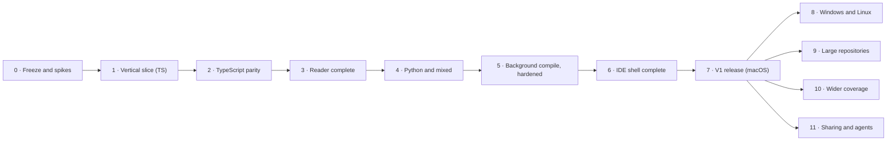

# Unfold migration plan

Status: plan for V1 and V2 · 2026-10-08

This plan takes us from the `graph-compiler` proof of concept to Unfold V1 and V2, phase by phase.

- [Architecture](architecture.md) describes what we are building.
- [Decisions and trade-offs](decisions-and-tradeoffs.md) explains why (U-1 to U-36).

## Summary

- **What "migration" means here.** The proof of concept was never deployed, so there are no users, installations, or data to convert. Apart from one sample board, we migrate knowledge, test data, measurements, and designs. We freeze the PoC, carry those things into a new `unfold` repository, build Unfold there from nothing, and then archive the PoC.
- **V1 is a macOS release.** It does everything the PoC does for TypeScript and Python, inside one desktop app with an IDE-shaped window. You press Compile once, and after that the graph keeps itself current in the background.
- **V2 widens it.** It adds Windows and Linux, large repositories with early-cutoff updates, wider coverage (JavaScript, more frameworks, more Flow routing, and an optional type checker), and sharing and agents.
- **Phases 0–7 lead to V1, and phases 8–11 to V2.** Every phase ends with a "done when" check, and every gate stays on once it is introduced.

## 1. Where we start

The proof of concept is the `graph-compiler` repository at commit `5c98a6e` (2026-10-08), a sibling folder of this repository.

| Part | What it is | Size |
| --- | --- | --- |
| Compiler | `compilers/codegraph/`: three producers (native TypeScript, checker-backed TypeScript, Python on pinned Pyright grammar), one shared backend, ten detectors, a validator, and transactional publication | About 19,000 lines of TypeScript, plus 13,500 lines of tests |
| Reader | `reader/`: a core, a loopback server, a React app, and a CLI | About 6,800 lines, including tests |
| Playgrounds | `ts-playground/` (Express, BullMQ, node-cron; 34 sources) and `py-playground/` (FastAPI, Celery, APScheduler; 50 sources) | 84 sources, 50 entrances, 56 targets |
| Fixtures and goldens | `compilers/codegraph/test/fixtures/`: worked, classes, entrances, the frozen v1 playground, Python, and the playground goldens | Six-file generations with exact rows and hashes |
| Evidence | `compilers/codegraph/reports/`: parity, recall, budgets, profiles | 113 MB |
| Docs | `docs/`: concepts, format, compiler, reader, testing, and decisions (92 entries) | The complete semantics |
| Designs | Paper file "Lazar's Playground", page "Code Graph - v7": v7.1 boards 06–10 and the v7.2 Arrange boards 11–14 | The UI reference |

**Recorded results.**
- **Tests:** 854 compiler tests, 57 reader tests, and 3 browser tests passed.
- **Precision:** 100% of resolved targets agree with the oracles.
- **TypeScript recall (native):** 96.0% on TypeScript's 602-file compiler source, 100% on the codegraph source, and 46 of 71 calls on the playground.
- **Python recall floors:** 91 of 96 on the playground, 185 of 232 on the FastAPI template, and 3 of 3 on the range corpus.
- **Native resources:** a serial build of the 602-file corpus took 11.3 s and peaked at 3.7 GB.

## 2. What moves and what stays

### Moves into `unfold`

| Item | In graph-compiler | In unfold | How |
| --- | --- | --- | --- |
| TypeScript playground | `ts-playground/` | `testdata/playgrounds/ts-orders/` | Copy the sources, `package.json`, and `tsconfig.json`. Never `node_modules` or `dist`. Tests never install or run it |
| Python playground | `py-playground/` | `testdata/playgrounds/py-orders/` | Copy the sources and `pyproject.toml`. Never environments or caches |
| Manual entrances | Root `codegraph.json` and the Python `codegraph.json` | `testdata/playgrounds/*/.unfold/config.toml` | Rewrite as `[[entrance]]` tables |
| Expected entrance trees | `docs/testing.md` ("Expected Entrances view") and `py-playground/expected-outcomes.md` | `testdata/playgrounds/*/expected-entrances.txt` | Rewrite as machine-checked expectations |
| Fixtures | `compilers/codegraph/test/fixtures/{worked,classes,entrances,playground-v1,python}` | `testdata/fixtures/` | Copy the sources. Their expected rows become reference outputs (next row) |
| Frozen outputs | The fixture goldens, both producers' playground goldens, the Python golden, the root mixed `.codecodegraph/`, and fresh builds of each corpus | `testdata/reference/poc/<corpus>/`, then the canonical form | Copy the raw generations, then convert them with `cargo xtask reference import`: UTF-16 to bytes, IDs to keys |
| Inline test cases | The focused suites in `compilers/codegraph/test/*.test.ts` | `testdata/detectors/<id>/<case>/` and `testdata/fixtures/` | Extract them phase by phase, as each phase lists below |
| Larger corpora | TypeScript 6.0.3 `src` (602 files), the codegraph source at the freeze commit, the FastAPI full-stack template 0.12.0 (47 files), and the spike corpus lock | `testdata/corpora.lock.toml` | Pinned by URL and hash, not copied |
| Oracle outputs | The checker-resolved targets per corpus, and the Pyright oracle rows | `testdata/reference/oracles/` | Cached by a hash of the corpus |
| Oracle tools | The Python reference harness and the checker comparison | `tools/oracles/` | Adapted as developer-only Node tools, with attribution |
| Baselines | Recall, precision, and budget numbers from `docs/testing.md` and `reports/` | `docs/testing.md`, as a baseline table | Summarized numbers only |
| Sample board | `codegraph/boards/order-placement.board.json` | `testdata/boards/order-placement.json` | Convert once to `unfold-board` version 1 |
| Semantics | `docs/format.md`, `compiler.md`, `reader.md`, `concepts.md`, `testing.md` | `docs/graph-model.md`, `languages/typescript.md`, `languages/python.md`, `entrances.md`, `reader.md`, `testing.md` | Rewrite with Unfold's names and byte offsets |
| Decisions | `docs/decisions.md` (D-1 to D-92) | `docs/decisions/` (U-1 onward) | The decisions still in force are already captured as U-n or in the semantics documents. The old log stays in the archive |
| Designs and tokens | Paper v7 and v7.1 boards; `reader/app/styles.css` | `ui/src/theme/` | Tokens carry over as data. Components are rewritten, with the PoC as a visual reference |

### Stays behind

| Item | Why |
| --- | --- |
| All compiler and reader code | Unfold is written fresh in Rust and React (U-2) |
| The TypeScript 6.0.3 fork (818 MB) and vendored Pyright (114 MB) | Replaced by oxc and Ruff's parser. The oracles use published packages |
| The CSV package format and the `.codecodegraph*` folders | Replaced by SQLite in `.unfold/local/cache/` |
| The HTTP server, server-sent events, polling, and the CLI | Replaced by Tauri commands, events, and the file watcher |
| `compilers/codegraph/reports/` (113 MB) | Only the summarized numbers move. The rest stays with the archive |
| The debug binder and analysis report, `codegraph.backup-before-implementation/`, and `spikes/` | Historical. Their conclusions are already recorded |

## 3. Name and file mapping

| Proof of concept | Unfold |
| --- | --- |
| Product "Codegraph" | Unfold |
| `compilers/codegraph/` in TypeScript | `crates/unfold-engine` and `crates/unfold-lang-*` in Rust |
| Native and checker-backed TypeScript producers | One oxc front end, with an optional TypeScript 7 checker later |
| Pinned Pyright 1.1.407 grammar | `ruff_python_parser`, pinned. Pyright's evaluator is used only as a developer oracle |
| Git-based discovery | A walk with the `ignore` crate, without running Git |
| `codegraph.json` | `.unfold/config.toml` |
| `.codecodegraph/`, six CSV files | `.unfold/local/cache/graph.sqlite` |
| The consistent-read protocol and directory swap | One SQLite transaction |
| Generation-wide IDs (`b1`, `b2`, …) | File-scoped IDs and structural keys |
| UTF-16 offsets in the package | UTF-8 in the engine, UTF-16 at the UI |
| `codegraph/boards/*.board.json` (`codegraph-board` version 3) | `.unfold/boards/*.json` (`unfold-board` version 1) |
| A board card's `state`, the board's `blocks` map | `view`, `labels` |
| `.codecodegraph-drafts/` | `.unfold/local/drafts/` |
| The Re-index button and producer replay | Compile, plus background updates |
| `reader/server`: HTTP, server-sent events, 750 ms polling | Tauri commands, events, and a file watcher |
| `reader/core` in TypeScript | `crates/unfold-reader` in Rust |
| `reader/app` | `ui/`, with the IDE shell |
| `reader/cli` Mermaid export | Export in the board menu; `cargo xtask export` for developers |
| Node 26 and npm scripts | Cargo, pnpm, and `just` |

## 4. Release overview

| Release | Phases | Theme |
| --- | --- | --- |
| **V1** | 0–7 | The PoC's capability as a macOS desktop app with an IDE frame and background compilation |
| **V2** | 8–11 | Every platform, large repositories, wider language and framework coverage, sharing, and agents |
| Later | | Graph diffs, links between languages, more languages, collaboration |

Phases 8–11 don't depend on each other. They can run in parallel, ship as 1.x updates when they finish, and together make up V2.

## 5. V1 phases

### Phase 0: Freeze the proof of concept and prove the risky parts

**Goal.** Capture everything the PoC knows. Test the four riskiest assumptions before building on them. Settle the name before it spreads into folders and formats.

**In graph-compiler.** These are the last changes it ever gets:
1. Tag its final commit `poc-final`. You do the Git operations.
2. Run the complete verification once: the compiler suite, the fork, self, and frozen lanes, the Python and mixed verification, the reader tests, and the browser smoke. Keep the logs.
3. Build fresh generations with both TypeScript producers for the fork corpus, the self corpus, and the playground, plus the Python generations for the playground and the FastAPI template. Keep the oracle outputs.
4. **Spike S1, the recall check.** Pick two real-world TypeScript backend repositories, pin them by commit, and run both producers on them. Record the native producer's recall against the checker, broken down by callee shape. Then apply the U-8 rule: at 90% or more on each, V1 has no checker. Otherwise, the TypeScript 7 provider joins V1.

**In unfold**
1. Set up the repository, which so far holds only these documents and its README. Add the Cargo and pnpm workspaces, `justfile`, `deny.toml`, the three CI workflows on all three platforms, the typed IPC generation, and the theme tokens.
2. Copy the items in [section 2](#2-what-moves-and-what-stays). Import the frozen generations into `testdata/reference/`, and record the source commit in `testdata/reference/README.md`.
3. Rewrite the semantics documents (`graph-model.md`, `languages/*.md`, `entrances.md`, `reader.md`, `testing.md`) and add the decision files.
4. Run the spikes:

| Spike | Question | Go when |
| --- | --- | --- |
| S2: oxc | Can oxc produce the PoC's blocks and slots, and does `oxc_semantic` match the binding rules? | It parses every file in the TypeScript fixtures and the 602-file corpus. Its block and slot ranges match the reference after offset conversion. Scoping matches on the binder fixtures, or we decide to port the binder onto oxc's tree. Time and memory are measured |
| S3: Ruff's parser | Can it handle the Python corpora at grammar versions 3.12–3.14 with exact ranges? | It parses the playground, the FastAPI template, and the range fixtures. Ranges and the call census match the reference. Syntax beyond the configured version is rejected |
| S4: the Tauri canvas | Do the v7.1 cards, Code, and Flow render well in WKWebView and WebKitGTK? | A 50-card board pans and zooms at 60 fps on macOS. Card sizes match within a pixel tolerance across engines. Linux is measured. If not, use the Electron fallback (U-6) |
| S5: packaging | Does a signed app open a folder and write to `.unfold/`? | A signed macOS dev build runs the folder picker, a typed command round trip, bundled SQLite with FTS5 in `.unfold/local/cache/`, and watcher events |

5. Run the trademark check on "Unfold", and choose the bundle identifier.

**Done when**
- The PoC is tagged and its reference is imported into `unfold`.
- Every spike has a recorded go or no-go.
- The U-8 recall decision is recorded.
- The name is settled.
- The app opens a folder and shows its file tree on all three platforms in CI.

### Phase 1: The first vertical slice (TypeScript)

**Goal.** One complete journey through the real architecture, including the update path:
1. Open `ts-orders` and press Compile.
2. Open `POST /orders`, follow `createOrder` into `OrderService.place`, and read the Code.
3. Save an edit and watch the card update.
4. Quit, relaunch, and find the draft.

**Build**

| Crate or area | Work |
| --- | --- |
| `unfold-core` | The model and vocabularies, structural keys, snapshots, SHA-256, the line index, the UTF-8 and UTF-16 mapping, part of the validator, and part of the canonical export |
| `unfold-engine` | Discovery with ignore rules and defaults, the facts cache, the `Language` and `Linked` traits, and `update(changes)` as the only entry point. The backend's block selection, roles, names, and slots. The value policy and reason order for evidence levels 1–3, enough to follow this path. Edges and entrance assembly |
| `unfold-lang-typescript` | The oxc adapter for this scope: imports, exports, constant initializers, classes, `new`, `this`, and members. The `express.route` detector, with its provenance |
| Manual entrances | `.unfold/config.toml` `[[entrance]]` tables |
| `unfold-store` | The schema, row diffs, single-transaction commits, and FTS5 for definitions |
| `unfold-reader` | Owner, catalog, the code render model, highlighting, and minimal drafts |
| `unfold-workspace` | Opening a folder, creating `.unfold/` on the first Compile, Compile with progress, and a simple watcher that feeds `update()` |
| `desktop` and `ui` | The welcome and first-Compile screens, the Files tree without outlines, a flat Entrances list, the Compile button and status bar, and a board with an entrance card and Code cards. Follow a call, go Back, autosave drafts, and restore after relaunch |

**Done when**
- In the packaged macOS app, the journey works end to end.
- A body edit to `order-service.ts` updates the open card within a second.
- Blocks and slots match the reference on the TypeScript fixtures and `ts-orders`, apart from listed divergences.
- The canonical export is identical across thread counts and input orders on the fixtures.

### Phase 2: TypeScript parity

**Goal.** The TypeScript graph equals the PoC's, apart from listed and explained divergences, at 100% precision.

**Build**
- **Binding.** The full binding rules, either on `oxc_semantic` or ported onto oxc's tree, as S2 decided.
- **Evidence and censuses.**
  - written-type receivers (evidence level 4);
  - the constant-object-member rule, which fixes C-2;
  - the override census;
  - parameter positions without explicit `this`, which fixes C-4.
- **Labels and imports.** The known-globals and library tables, generated by `cargo xtask gen-lib-tables`. Module labels and provenance (C-6). Runtime import selection and type-only erasure (C-12).
- **Configuration.** `tsconfig` groups and module resolution: `paths`, `baseUrl`, `extends`, `exports`, and extension aliasing. The emit map.
- **Detectors.** The launch-command grammar with `package.script` and `package.bin` (C-5). `bullmq.worker`, `node-cron.schedule`, Express mounts, and every manual locator form.
- **Checks and tools.** The full validator and canonical export. `cargo xtask parity` with `divergences.toml`. The TypeScript checker oracle in `tools/oracles/`. Determinism tests on the corpora. Fuzzing the TypeScript adapter.
- **Open questions.** Decide C-8 and C-9 with fixtures, and record the outcomes as decisions.
- **Extracted cases.** The focused suites for references, values, imports, launches, manual entrances, Express, and jobs become cases in `testdata/`.

**Measure.** These numbers set the budgets:
- first Compile time and peak memory on the 602-file corpus, aiming for under 5 s and 1 GB;
- update latency on the 602-file corpus and on a 2,000-file application repository.

**Done when**
- **Precision** against the checker oracle is 100% on the fixtures, `ts-orders`, the 602-file corpus, the self corpus, and the two Phase 0 repositories.
- **Recall** is at least the PoC native producer's on every corpus: 96.0% or more on the 602-file corpus, 100% on the self corpus, and at least 46 of 71 on `ts-orders`. We expect `ts-orders` to reach about 71 with the C-2 rule. The floors then rise to whatever is achieved.
- **Entrances.** The `ts-orders` tree exactly matches the expected one, with 25 entrances and 28 targets.
- **Fuzzing.** A nightly run finds no crash.

### Phase 3: The reader, complete

**Goal.** Everything the v7.1 reader does, in the desktop app.

**Build**
- **Derived views.** Closure, applications and membership, and relations, including reached-from.
- **Flow.** The Flow model, with lanes, conditions, `else if` chains, loops, early exits, `try`/`catch`, opaque regions, and fallback labels. Mermaid export.
- **Boards.**
  - the `unfold-board` version 1 format and its JSON Schema;
  - validation, signatures, guards, and health and repair;
  - drafts, Publish to `.unfold/boards/`, Move back to drafts, Rename, and Delete;
  - reloading after external edits, and the conflict prompt;
  - the converted sample board.
- **Canvas.**
  - content-sized cards with reflow, and an arrow for each call occurrence;
  - folding, Fit, zoom as a camera, and the lens;
  - Arrange by call depth with Undo;
  - groups made from the gutter, descriptions, and labels.
- **Inspector and outline.** The inspector (calls, callers, descriptions, labels, groups), the Boards view with its outline, and undo and redo for board edits.

**Done when**

The PoC's browser journeys pass as desktop journeys:
1. Open `POST /orders`, follow into `createOrder` and `OrderService.place`, switch Code and Flow, and go Back.
2. Check that Fit shows every card, that zooming leaves card heights unchanged, and that the top switch writes nothing.
3. Label a Flow node, group lines, and fold a card. Relaunch and check that the draft and the fold survived.
4. Publish, and load a board written directly to disk.

In addition:
- The sample board loads with every description and label attached and healthy.
- Mermaid output parses with the real Mermaid parser and matches its snapshots.
- Boards serialize identically after a load-and-save round trip.

### Phase 4: Python and mixed repositories

**Goal.** Python, and mixed TypeScript and Python folders, equal the PoC.

**Build**
- **Ruff adapter.** Structure, the `header` role, and the Python slots and kinds.
- **Binder.**
  - the write census and NFKC identity;
  - reflection refusals;
  - C3 lookup, receivers, and the metaclass rules;
  - the decorator allowlist;
  - imports, source roots, and `TYPE_CHECKING`;
  - named child imports.
- **Detectors.** `pyproject.script` with TOML evidence, `fastapi.route` with mounts and `Depends`, `celery.task`, and `apscheduler.job`. Python Flow, with its opaque regions.
- **Oracles and tests.** The Pyright oracle in `tools/oracles/`, fuzzing the Python adapter, and the Python policy fixtures.

**Done when**
- `py-orders` matches the reference apart from listed divergences.
- Precision against the Pyright oracle is 100%.
- Recall is at least 91 of 96 on the playground, 185 of 232 on the FastAPI template, and 3 of 3 on the range corpus.
- The 84-file mixed playground matches: each language's facts are identical to its single-language build, and no edge crosses languages.
- Grammar versions 3.12–3.14 behave as configured.
- A Unicode Python call can be followed in the app.
- Console-script entrances show their TOML evidence.

### Phase 5: Background compile, hardened

**Goal.** Background updates you can trust with your daily work.

**Build**
- **Watching.** Batching and debounce, cancelling and restarting on newer changes, low-priority threads, and the pause switch.
- **Files in trouble.** Last-good facts with dimmed renders, and file states in the tree and status bar.
- **Changes around the code.** Settings and input changes, reopening with cheap size and time checks, and engine-version recompiles.
- **Storage edge cases.** The per-folder lock, the fallback location for read-only and network folders, and recovery when `.unfold/local/cache/` is deleted.
- **Watcher limits.** Detecting overflow and inotify limits, and falling back to scanning.

**Done when**
- **Incremental equals full.** The property tests run nightly with long randomized edit sequences on both playgrounds and the 602-file corpus. Every sequence ends with a canonical export identical to a fresh compile of the same effective inputs.
- **Latency.** From save to `graph_updated` takes under 1 s at the 95th percentile on the 2,000-file benchmark repository. If it doesn't, Phase 9's early cutoff moves into V1.
- **Journeys.** Each of these passes:
  - break a file and fix it;
  - switch branches across 500 files, ending equal to a fresh compile;
  - edit files while the app is closed;
  - use a read-only folder;
  - delete the cache.

### Phase 6: The IDE shell, complete

**Goal.** The window from [architecture §11](architecture.md#11-the-desktop-app), complete.

**Build**
- **Files.** Outlines in the tree; the marks for entrances, the board, changed, and failed files; the context menu, including the scope actions, Open in editor, and Reveal in Finder.
- **Entrances.** Grouped by application, with launches, unindexed launches, and language tags.
- **Search.** Definitions, entrances, files, and text, with ⌘P and ⌘T quick open.
- **Source tabs.** Virtualized, with call links and the `⊕` gutter.
- **Panels.** Reached-from in the inspector, and Problems, Index log, and References in the bottom panel.
- **The rest of the window.** The command palette and keyboard map, the dark theme, the manual entrance editor (which writes `config.toml` and keeps comments), and the preferences window.
- **Accessibility.** Focus order, keyboard-only use, and contrast in both themes.

**Done when**
- The shell journeys pass: browse and outline, scope changes trigger updates, search in every tab, follow a call from a source tab, and add a definition with `⊕`.
- A keyboard-only journey passes.
- The dark-theme screenshots are reviewed.
- Editing a manual entrance round-trips through `config.toml`.

### Phase 7: V1 release on macOS

**Goal.** A signed product that you can install and that updates itself.

**Build**
- **Signing and updates.** Signing and notarization, the updater with signed manifests on GitHub Releases, and an update test from one release to the next.
- **Guidance.** The welcome and first-Compile copy, a short user guide, and Copy diagnostics.
- **Budgets.** Ratify them on the reference machine.
- **Licenses.** Notices for oxc, Ruff, Tauri, and the tables generated from TypeScript's `lib` files, checked with cargo-deny.
- **The final run.** Run every gate on the release candidate.

**Done when**
- A signed, notarized DMG installs on a clean Mac with no Node or Python, and opens and compiles both playgrounds.
- It updates itself to a test release.
- Every V1 gate passes.
- Windows and Linux CI are still green.

## 6. What V1 looks like

V1 is a Mac app that you point at a TypeScript or Python repository, or a mixed one:

- You press **Compile** once. Unfold creates `.unfold/` and shows the entrances, meaning the routes, workers, schedules, commands, and launch scripts, grouped by application.
- You open one and follow its calls card by card. You read each function as exact source or as a Flow diagram, and explain the path with descriptions, labels, and groups.
- You publish the board into the repository.
- While you keep working in your editor, the graph and the open cards follow every save.

| Area | In V1 |
| --- | --- |
| App | macOS (Apple silicon and Intel), signed and notarized, updating itself. Welcome screen, recent folders, open by ⌘O or drag and drop |
| Compiling | Compile; background updates on save; pause; Rebuild from scratch; progress and cancel; last-good handling for broken files; fast reopen |
| Languages | TypeScript (`.ts`, `.tsx`, `.mts`, `.cts`) and Python 3.12–3.14, alone or mixed |
| Entrances | Manual, `package.json` scripts and bins, Express (with mounts), BullMQ, node-cron, console scripts, FastAPI (with mounts and `Depends`), Celery, APScheduler |
| Graph | Blocks, slots, calls, constructions, imports, and passed references, with resolutions and reasons. 100% precision on the pinned corpora |
| Reader | Entrance and block cards; Code with colors, folds, links, peek, and inline expand; Flow with labels and opaque regions; an arrow for each call; fold, Arrange, Fit, the lens, Back and the trail |
| Boards | Drafts, Publish to `.unfold/boards/`, Move back to drafts, Rename, Delete, health and repair, external-edit reload, Mermaid export |
| Window | Files with outlines, Entrances, Search (including text), Boards with outline, source tabs, inspector with reached-from, Problems, Index log, References, status bar, command palette, keyboard map, light and dark themes |
| Settings | Scope from the tree, the manual entrance editor, Python projects, and preferences |

**Not in V1**
- Windows and Linux releases (they are built in CI).
- JavaScript.
- The type checker, unless the Phase 0 recall check requires it.
- Early-cutoff updates.
- Frameworks beyond the nine detectors above.
- SVG, PNG, and Markdown export.
- An agent interface, and AI-drafted labels.
- Follow all.
- Frames, notes, and nested groups.
- Package-aware grouping.
- Graph diffs.
- Any editing of code.

**V1 release gates**

| Gate | Requirement |
| --- | --- |
| Precision | 100% of resolved calls and named references agree with the oracles on every pinned corpus, in both languages |
| Recall | At or above every recorded floor; floors only rise |
| Reference parity | No unlisted divergences, and no stale entries in `divergences.toml` |
| Determinism | Identical canonical exports across input orders, thread counts, and update histories |
| Incremental equals full | Passes nightly on randomized edit sequences |
| Journeys | Reader, shell, background-compile, and packaged-app journeys all pass |
| Budgets | First Compile, update latency, search, card open, frame rate, and memory within the ratified budgets |
| Safety | Execution sentinels never run; nothing is written outside `.unfold/` and the app's own folders; the app works with no Node or Python installed |

## 7. V2 phases

### Phase 8: Windows and Linux

**Build**
- Fix the rendering and input differences between WebView2 and WebKitGTK.
- A signed Windows installer, with WebView2 bootstrapped on Windows 10.
- An AppImage, plus `.deb` and `.rpm` packages.
- The updater on both platforms.
- The inotify-limit message on Linux.
- The platform-specific path and case tests.

**Done when** the visual and end-to-end suites pass on both platforms, and signed builds install and update on clean machines.

### Phase 9: Large repositories

**Build**
- **Early cutoff** ([architecture §7.4](architecture.md#74-v2-early-cutoff)):
  - separate interface and body hashes;
  - records of what each resolution consulted, and of census entries;
  - tracking of failed lookups, so that created and deleted paths re-resolve the files that missed them.
- **Reader projections** updated incrementally.
- **Large corpora.** Pin a corpus of 10,000 files or more and set budgets on it.
- **Monorepos.** Package-aware grouping in Files and Entrances for npm and pnpm workspaces and Python projects.
- **Subfolders.** When you open a subfolder, an offer to open the enclosing folder that already has `.unfold/`.
- **Personal scope.** A personal scope layer, if it's been asked for.

**Done when**
- Incremental equals full with early cutoff turned on.
- Updates after body-only edits take under 300 ms.
- The large-corpus budgets hold.

### Phase 10: Wider coverage

**Build**
- **JavaScript.** ES modules first, then CommonJS with its own binding rules.
- **The type checker.** The TypeScript 7 checker provider, if it didn't already join V1 (U-8).
- **New detectors.** Next.js routes, from the PoC's existing specification, plus NestJS, Flask, and Django, chosen by demand. Each goes through the detector checklist: positive forms, decoys, aliases, spreads, evidence ranges, and refusals.
- **Deferred TypeScript forms.** Express `app.route()` chains, and TypeScript decorator routing.
- **Flow routing.** Where it can be proven: `switch` and `try`/`finally`, and Python `with`, `match`, loops with `else`, and `try`/`except`. File-initialization Flow.

**Done when** every addition passes its fixtures, the oracle gates hold, and the recall floors are updated.

### Phase 11: Sharing and agents

**Build**
- **Exports.** SVG and PNG, and a Markdown walkthrough of a board's cards and descriptions.
- **Follow all.** The static call tree from an entrance to a chosen depth, then Arranged.
- **Agent access.** A local, read-mostly interface, such as MCP, so coding agents can ask "what reaches this?" and propose labels. It starts with its own design.
- **Drafted labels.** Optional AI-drafted Flow labels, attributed `agent:…` and accepted one at a time. They are off by default.
- **Board authoring.** Frames, free notes, and nested groups, in board format version 2 with a migration from version 1.
- **Board health in CI.** A way to check board health in CI, designed so that it doesn't become a separate product.

**Done when** each feature passes its tests and doesn't weaken any V1 guarantee.

## 8. What V2 looks like

V2 is Unfold on every desktop platform, on repositories of any size, for more of the code people actually write. It adds:

- Windows and Linux releases;
- early-cutoff updates that touch only what an edit can affect;
- JavaScript;
- more frameworks;
- Flow that routes through more structures;
- an optional type checker for higher TypeScript recall;
- richer exports and board authoring;
- a proper interface for coding agents.

| Area | Added in V2 |
| --- | --- |
| Platforms | Windows 10 and 11, and Linux, both signed and updating themselves |
| Scale | Early cutoff, budgets on 10,000+ files, monorepo-aware grouping |
| Languages | JavaScript (ES modules, then CommonJS) |
| Evidence | An optional TypeScript 7 checker provider |
| Frameworks | Next.js, plus NestJS, Flask, and Django as needed |
| Flow | Proven routing through more structures, and file-initialization Flow |
| Sharing | SVG, PNG, and Markdown exports |
| Agents | A local agent interface, and opt-in drafted labels |
| Boards | Frames, notes, nested groups (format version 2), and Follow all |

**V2 gates.** These are all the V1 gates, plus:
- the platform suites;
- incremental equals full with early cutoff turned on;
- the large-repository budgets;
- each new detector's checklist.

## 9. Later (V3 and beyond)

These are candidates, each starting with its own short proposal:
- **Graph diffs** between revisions: changed functions, calls, and entrances.
- **Links between languages** from explicit evidence, such as OpenAPI contracts, generated clients, or route declarations.
- **More languages**, such as Go, Java, Kotlin, and C#.
- **Hosted sharing and collaboration.**
- **Runtime traces**, as a separate layer that refers to blocks.
- **A plugin interface** for detectors.

## 10. Gates by phase

| Gate | Introduced in | Then applies to |
| --- | --- | --- |
| The packaged app opens a folder | Phase 0 | Every phase |
| Block and slot parity with the reference (TypeScript) | Phase 1 | Every phase |
| Determinism: basic in Phase 1, on the corpora in Phase 2 | Phases 1 and 2 | Every phase |
| 100% precision and recall floors (TypeScript) | Phase 2 | Every phase |
| Fuzzing (TypeScript in Phase 2, Python in Phase 4) | Phases 2 and 4 | Nightly |
| Reader journeys | Phase 3 | Every phase |
| Python parity, precision, and recall; mixed parity | Phase 4 | Every phase |
| Incremental equals full: basic in Phase 1, randomized nightly in Phase 5 | Phases 1 and 5 | Every phase |
| Update latency | Phase 5 | Every phase |
| Shell journeys | Phase 6 | Every phase |
| Ratified budgets; signed release | Phase 7 | Every release |
| Windows and Linux suites | Phase 8 | Every release |
| Early-cutoff equality; large-repository budgets | Phase 9 | Every release |

## 11. Retiring the proof of concept

1. **End of Phase 0.** The PoC is tagged `poc-final` and frozen. It gets no more changes.
2. **Phases 1–4.** It is used read-only, to answer "what did the PoC do here?" and to regenerate oracle outputs if needed.
3. **End of Phase 4.** With parity in both languages, the repository is archived as read-only. `unfold` holds everything it needs: reference outputs, a corpus lock, fixtures, playgrounds, and documentation.
4. **After V1.** Nothing depends on the PoC.

## 12. If something fails

| If | Then |
| --- | --- |
| S1: native recall is below 90% of the checker's on real repositories | The TypeScript 7 checker provider joins V1, after Phase 6. If its API isn't stable yet, we decide between shipping V1 with lower, explained recall and waiting |
| S2: `oxc_semantic` doesn't match the binding rules | Port the PoC's binder onto oxc's tree in Phase 2 |
| S2: oxc mishandles syntax the corpora need | Pin a version that works and report the problem upstream; such files are reported as failed until it's fixed |
| S3: Ruff's parser API is unusable, or its version checks are insufficient | Vendor the parser at a tag, and implement the version checks ourselves |
| S4: the canvas fails on WebKit | Electron with a native addon, keeping the same engine crates (U-6) |
| Phase 5: update latency is over the limit | Move Phase 9's early cutoff into V1 |
| Incremental results ever differ from a full compile | Treat it as a release blocker. V1's full relink is the fallback by design |
| The trademark check fails | Rename in Phase 0, before the name reaches folders, formats, and the bundle identifier |
