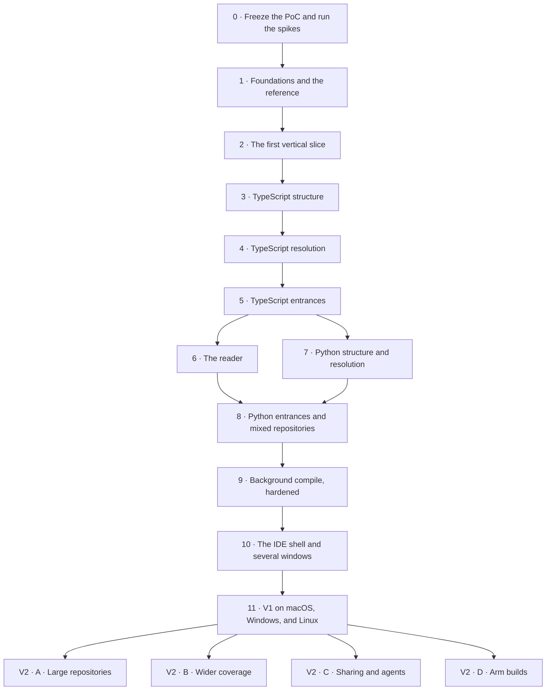

# Unfold migration plan

Status: plan for V1 and V2 · 2026-10-08

This plan takes us from the `graph-compiler` proof of concept to Unfold, one step at a time.

- [Architecture](architecture.md) describes what we are building.
- [Decisions and trade-offs](decisions-and-tradeoffs.md) explains why (U-1 to U-51).

This plan is the record of how V1 was built. Its window (Steps 2 and 10: the activity bar, source tabs, the inspector, the bottom panel, the status bar, the command palette, and windows per folder) was V1's IDE-shaped workbench, which the studio redesign replaced after V1 was built ([How we got here](decisions-and-tradeoffs.md#the-studio-redesign), [U-26](decisions-and-tradeoffs.md#u-26-a-studio-window)). The window as it is now is [architecture §11](architecture.md#11-the-desktop-app).

## Summary

- **What "migration" means here.** The proof of concept was never deployed, so there are no users, installations, or data to convert. Apart from one sample board, we migrate knowledge, test data, measurements, and designs. We freeze the PoC, carry those things into the `unfold` repository, and rebuild the PoC's parts there one at a time. Once both languages match, we archive the PoC.
- **One part of the PoC per step.** The migration has twelve steps, 0 to 11. Each one takes a part of the PoC, rebuilds it in Unfold, and proves that the result matches the PoC's frozen outputs, apart from listed and explained divergences. After that step, nobody needs to consult that part of the PoC again. [Section 4](#4-the-migration-map) maps every part to its step.
- **A working app from Step 2.** Step 2 runs one journey through every layer, so every later step deepens an app that already works (U-36).
- **Every platform, every step.** Unfold runs on macOS, Windows, and Linux in CI from the first commit. A step is done only when its journeys pass on all three, and V1 ships on all three at once (U-35).
- **V1 is the end of the migration.** It does everything the PoC does for TypeScript and Python, in one Electron app with an IDE-shaped window, several windows per folder, and background compilation.
- **V2 goes beyond the PoC**, in four independent tracks: large repositories, wider coverage, sharing and agents, and Arm builds.
- **Gates stay on.** Every step ends with a "done when" check, and every gate stays on once it is introduced.

## 1. Where we start

The proof of concept is the `graph-compiler` repository at commit `5c98a6e` (2026-10-08), a sibling folder of this repository.

| Part | What it is | Size |
| --- | --- | --- |
| Compiler | `compilers/codegraph/`: three producers (native TypeScript, checker-backed TypeScript, Python on pinned Pyright grammar), one shared backend, ten detectors, a validator, and transactional publication | About 19,000 lines of TypeScript, plus 13,500 lines of tests |
| Reader | `reader/`: a core, a loopback server, a React app, and a CLI | About 6,800 lines, including tests |
| Playgrounds | `ts-playground/` (Express, BullMQ, node-cron; 34 sources) and `py-playground/` (FastAPI, Celery, APScheduler; 50 sources) | 84 sources, 50 entrances, 56 targets |
| Fixtures and goldens | `compilers/codegraph/test/fixtures/`: worked, classes, entrances, the frozen v1 playground, Python, and the playground goldens | Six-file generations with exact rows and hashes |
| Evidence | `compilers/codegraph/reports/`: parity, recall, budgets, profiles | 113 MB |
| Docs | `docs/`: concepts, format, compiler, reader, testing, and decisions (92 entries) | The complete semantics |
| Designs | Paper file "Lazar's Playground", page "Code Graph - v7": v7.1 boards 06–10 and the v7.2 Arrange boards 11–14 | The UI reference |

**Recorded results.**
- **Tests:** 854 compiler tests, 57 reader tests, and 3 browser tests passed.
- **Precision:** 100% of resolved targets agree with the oracles.
- **TypeScript recall (native):** 96.0% on TypeScript's 602-file compiler source, 100% on the codegraph source, and 46 of 71 calls on the playground.
- **Python recall floors:** 91 of 96 on the playground, 185 of 232 on the FastAPI template, and 3 of 3 on the range corpus.
- **Native resources:** a serial build of the 602-file corpus took 11.3 s and peaked at 3.7 GB.

## 2. What moves and what stays

### Moves into `unfold`

| Item | In graph-compiler | In unfold | How |
| --- | --- | --- | --- |
| TypeScript playground | `ts-playground/` | `testdata/playgrounds/ts-orders/` | Copy the sources, `package.json`, and `tsconfig.json`. Never `node_modules` or `dist`. Tests never install or run it |
| Python playground | `py-playground/` | `testdata/playgrounds/py-orders/` | Copy the sources and `pyproject.toml`. Never environments or caches |
| Manual entrances | Root `codegraph.json` and the Python `codegraph.json` | `testdata/playgrounds/*/.unfold/config.toml` | Rewrite as `[[entrance]]` tables |
| Expected entrance trees | `docs/testing.md` ("Expected Entrances view") and `py-playground/expected-outcomes.md` | `testdata/playgrounds/*/expected-entrances.txt` | Rewrite as machine-checked expectations |
| Fixtures | `compilers/codegraph/test/fixtures/{worked,classes,entrances,playground-v1,python}` | `testdata/fixtures/` | Copy the sources. Their expected rows become reference outputs (next row) |
| Frozen outputs | The fixture goldens, both producers' playground goldens, the Python golden, the root mixed `.codecodegraph/`, and fresh builds of each corpus | `testdata/reference/poc/<corpus>/`, then the canonical form | Copy the raw generations, then convert them with `cargo xtask reference import`: UTF-16 to bytes, IDs to keys |
| Reader reference | What `reader/core` and `reader/cli` compute for both playgrounds and the sample board: the catalog, applications and memberships, relations, closures, and Mermaid | `testdata/reference/poc-reader/<playground>/` | Exported once in Step 0 by a developer-only script in `tools/oracles/`, which reads the PoC at `poc-final` without changing it |
| Inline test cases | The focused suites in `compilers/codegraph/test/*.test.ts` | `testdata/detectors/<id>/<case>/` and `testdata/fixtures/` | Extract them step by step, as each step lists below |
| Larger corpora | TypeScript 6.0.3 `src` (602 files), the codegraph source at the freeze commit, the FastAPI full-stack template 0.12.0 (47 files), and the spike corpus lock | `testdata/corpora.lock.toml` | Pinned by URL and hash, not copied |
| Oracle outputs | The checker-resolved targets per corpus, and the Pyright oracle rows | `testdata/reference/oracles/` | Cached by a hash of the corpus |
| Oracle tools | The Python reference harness and the checker comparison | `tools/oracles/` | Adapted as developer-only Node tools, with attribution |
| Baselines | Recall, precision, and budget numbers from `docs/testing.md` and `reports/` | `docs/testing.md`, as a baseline table | Summarized numbers only |
| Sample board | `codegraph/boards/order-placement.board.json` | `testdata/boards/order-placement.json` | Convert once to `unfold-board` version 1 |
| Semantics | `docs/format.md`, `compiler.md`, `reader.md`, `concepts.md`, `testing.md` | `docs/graph-model.md`, `languages/typescript.md`, `languages/python.md`, `entrances.md`, `reader.md`, `testing.md` | Rewrite with Unfold's names and byte offsets |
| Decisions | `docs/decisions.md` (D-1 to D-92) | `docs/decisions/` (U-1 onward) | The decisions still in force are already captured as U-n or in the semantics documents. The old log stays in the archive |
| Designs and tokens | Paper v7 and v7.1 boards; `reader/app/styles.css` | `ui/src/theme/` | Tokens carry over as data. Components are rewritten, with the PoC as a visual reference |

### Stays behind

| Item | Why |
| --- | --- |
| All compiler and reader code | Unfold is written fresh in Rust and React (U-2) |
| The TypeScript 6.0.3 fork (818 MB) and vendored Pyright (114 MB) | Replaced by oxc and Ruff's parser. The oracles use published packages |
| The CSV package format and the `.codecodegraph*` folders | Replaced by SQLite in `.unfold/local/cache/` |
| The HTTP server, server-sent events, polling, and the CLI | Replaced by the Electron app: the engine host's commands and events, the file watcher, and Export in the board menu |
| `compilers/codegraph/reports/` (113 MB) | Only the summarized numbers move. The rest stays with the archive |
| The debug binder and analysis report, `codegraph.backup-before-implementation/`, and `spikes/` | Historical. Their conclusions are already recorded |

## 3. Name and file mapping

| Proof of concept | Unfold |
| --- | --- |
| Product "Codegraph" | Unfold |
| `compilers/codegraph/` in TypeScript | `crates/unfold-engine` and `crates/unfold-lang-*` in Rust |
| Native and checker-backed TypeScript producers | One oxc front end, with an optional TypeScript 7 checker later |
| Pinned Pyright 1.1.407 grammar | `ruff_python_parser`, pinned. Pyright's evaluator is used only as a developer oracle |
| Git-based discovery | A walk with the `ignore` crate, without running Git |
| `codegraph.json` | `.unfold/config.toml` |
| `.codecodegraph/`, six CSV files | `.unfold/local/cache/graph.sqlite` |
| The consistent-read protocol and directory swap | One SQLite transaction |
| Generation-wide IDs (`b1`, `b2`, …) | File-scoped IDs and structural keys |
| UTF-16 offsets in the package | UTF-8 in the engine, UTF-16 at the UI |
| `codegraph/boards/*.board.json` (`codegraph-board` version 3) | `.unfold/boards/*.json` (`unfold-board` version 1) |
| A board card's `state`, the board's `blocks` map | `view`, `labels` |
| `.codecodegraph-drafts/` | `.unfold/local/drafts/` |
| The Re-index button and producer replay | Compile, plus background updates |
| `reader/server`: HTTP, server-sent events, 750 ms polling | The engine host's commands and events, and a file watcher |
| A browser tab on a loopback server | Electron windows, several per folder |
| `reader/core` in TypeScript | `crates/unfold-reader` in Rust |
| `reader/app` | `ui/`, with the IDE shell, inside the Electron app in `desktop/` |
| `reader/cli` Mermaid export | Export in the board menu; `cargo xtask export` for developers |
| Node 26 and npm scripts | Cargo, pnpm, and `just` |

## 4. The migration map

Every part of the PoC, the step that migrates it, and the check that proves Unfold matches it.

| Part of the PoC | Becomes in Unfold | Step | How we prove it matches |
| --- | --- | --- | --- |
| Git-based discovery | A walk with ignore rules, in `unfold-engine` | 1 | The same file sets as the PoC on every corpus, apart from listed differences |
| The CSV package: records, UTF-16 offsets, generation-wide IDs | `unfold-core`: the model, byte offsets, structural keys, and the canonical export | 1 | Every frozen generation imports into canonical form, with its record counts and keys intact |
| The loopback server, server-sent events, and the browser tab | The Electron app: the main process, the engine host, and windows | 2 | The Step 2 journey, on all three platforms |
| Transactional publication and consistent reads | `unfold-store`: SQLite, one transaction per update | 2, hardened in 9 | Store fault tests, and incremental equals full |
| The native TypeScript producer's syntax mapping | `unfold-lang-typescript` on oxc, and the backend's block selection | 3 | Block and slot parity on every TypeScript corpus |
| The native producer's binding, evidence, censuses, modules, and labels | TypeScript linking and the shared value policy | 4 | Edge parity, 100% precision against the checker oracle, and recall at or above the floors |
| The launch grammar and the TypeScript detectors | The launch grammar in `unfold-engine`, and the detectors in `unfold-lang-typescript` | 5 | The `ts-orders` entrance tree: 25 entrances and 28 targets |
| `reader/core`: the derivations | `unfold-reader` | 6 | Parity with the reader reference, on `ts-orders` in Step 6 and `py-orders` in Step 8 |
| `reader/app`: cards, Code, Flow, boards, and the canvas | `ui/` | 6 | The PoC's browser journeys, passed as desktop journeys |
| `codegraph-board` version 3 | `unfold-board` version 1 | 6 | The converted sample board loads with every description and label attached and healthy |
| The Python producer's structure, on Pyright's grammar | `unfold-lang-python` on Ruff's parser | 7 | Block, slot, and call-census parity on every Python corpus |
| The Python binder | Python linking | 7 | Edge parity, 100% precision against the Pyright oracle, and the recall floors |
| The Python detectors, and mixed repositories | The detectors in `unfold-lang-python`, and one graph for both languages | 8 | The `py-orders` entrance tree, and the 84-file mixed playground |
| Re-index, producer replay, and the 750 ms polling loop | Background updates | 2, hardened in 9 | Incremental equals full, nightly, on randomized edit sequences |
| The single sidebar and its flat Definitions list | The IDE-shaped window, and several windows | 10 | The shell and window journeys |
| Nothing: the PoC was never packaged | Signed, self-updating apps for macOS, Windows, and Linux | 11 | Clean-machine installs and updates on each platform |

## 5. Overview

| Release | Steps | Theme |
| --- | --- | --- |
| **V1** | 0–11 | The PoC's capability for TypeScript and Python, in an Electron app on macOS, Windows, and Linux, with an IDE frame, several windows, and background compilation |
| **V2** | Tracks A–D | Large repositories, wider coverage, sharing and agents, and Arm builds |
| Later | | Graph diffs, links between languages, more languages, collaboration |

Steps run in order, except that a step can start once the steps it builds on are done. Step 7 builds on the shared backend that Steps 2 to 5 complete, not on the reader, so it can run beside Step 6. Step 8 waits for both. The V2 tracks don't depend on each other. They can run in parallel, ship as 1.x updates when they finish, and together make up V2.

Each step names these four things, where they apply:
- **From the PoC:** what it takes from the proof of concept.
- **Build:** what it adds to Unfold.
- **Done when:** the checks that prove it. App journeys must pass on macOS, Windows, and Linux.
- **Replaces:** the part of the PoC that nobody needs to consult after this step.

## 6. The steps

### Step 0: Freeze the proof of concept and prove the risky parts

**Goal.** Capture everything the PoC knows. Test the riskiest assumptions before building on them. Settle the name before it spreads into folders and formats.

**In graph-compiler.** These are the last times it runs. After them, it is only read:
1. Tag its final commit `poc-final`. You do the Git operations.
2. Run the complete verification once: the compiler suite, the fork, self, and frozen lanes, the Python and mixed verification, the reader tests, and the browser smoke. Keep the logs.
3. Build fresh generations with both TypeScript producers for the fork corpus, the self corpus, and the playground, plus the Python generations for the playground and the FastAPI template. Keep the oracle outputs.
4. Export the reader reference: run the developer-only script from `unfold/tools/oracles/` against `reader/core` and `reader/cli` at `poc-final`. The PoC itself doesn't change.
5. **Spike S1, the recall check.** Pick two real-world TypeScript backend repositories, pin them by commit, and run both producers on them. Record the native producer's recall against the checker, broken down by callee shape. Then apply the U-8 rule: at 90% or more on each, V1 has no checker. Otherwise, the TypeScript 7 provider joins V1.

**In unfold.** Run the spikes:

| Spike | Question | Go when |
| --- | --- | --- |
| S2: oxc | Can oxc produce the PoC's blocks and slots, and does `oxc_semantic` match the binding rules? | It parses every file in the TypeScript fixtures and the 602-file corpus. Its block and slot ranges match the reference after offset conversion. Scoping matches on the binder fixtures, or we decide to port the binder onto oxc's tree. Time and memory are measured |
| S3: Ruff's parser | Can it handle the Python corpora at grammar versions 3.12–3.14 with exact ranges? | It parses the playground, the FastAPI template, and the range fixtures. Ranges and the call census match the reference. Syntax beyond the configured version is rejected |
| S4: the canvas and windows | Do the v7.1 cards, Code, and Flow render well in Electron, with several windows open? | A 50-card board pans and zooms at 60 fps on each platform's reference machine. With the bundled fonts, card sizes match within a pixel tolerance across macOS, Windows, and Linux. Three windows on one folder stay within the memory budget for each window |
| S5: packaging | Do signed apps open a folder and write to `.unfold/` on every platform? | A notarized macOS build, a signed Windows installer, and a Linux AppImage each run the folder picker, a typed command round trip, bundled SQLite with FTS5 in `.unfold/local/cache/`, and watcher events. Each one updates itself from one test build to the next |
| S6: the engine host | Can the Rust addon, in a utility process, serve several windows? | Two windows on one folder receive the same `graph_updated` event. The trip through the engine host adds under 10 ms to a card-sized command. A Rust panic comes back as an error. Stopping the engine host mid-compile is recovered: both windows reconnect, and the graph is intact |

Also in Step 0:
- Run the trademark check on "Unfold", and choose the bundle identifier and the Windows app ID.
- Order the signing certificates: an Apple Developer ID, and a Windows code-signing certificate or a cloud signing service. They take time to issue.

**Done when**
- The PoC is tagged, and its generations, oracle outputs, and reader reference are exported.
- Every spike has a recorded go or no-go.
- The U-8 recall decision is recorded.
- The name, the bundle identifier, and the app ID are settled.
- The signing certificates are ordered.

**Replaces.** Running the PoC. From here on it is only read, at `poc-final`.

### Step 1: Lay the foundations and import the reference

**Goal.** A repository that builds and tests on all three platforms, holds everything carried over from the PoC, and can compare Unfold's output with the PoC's.

**From the PoC.** Everything in [section 2](#2-what-moves-and-what-stays): the playgrounds, fixtures, frozen generations, reader reference, corpus pins, oracle tools, baselines, sample board, semantics, and design tokens.

**Build**

| Area | Work |
| --- | --- |
| Repository | The Cargo and pnpm workspaces, `justfile`, `deny.toml`, and the three CI workflows on macOS, Windows, and Linux |
| `unfold-core` | The model and vocabularies, structural keys, snapshots, SHA-256, the line index, the UTF-8 and UTF-16 mapping, and the canonical export |
| Reference | `cargo xtask reference import`, which converts the frozen generations into canonical form under `testdata/reference/` and stores the reader reference beside them, with the source commit recorded in `testdata/reference/README.md`. An empty `divergences.toml` |
| Discovery | The walk with the `ignore` crate, its default exclusions, and `[scope]` |
| `unfold-node` and `desktop/` | The addon's surface (open, dispatch, cancel, subscribe), the engine host, the main process with its security settings, the preload script, and `cargo xtask gen-ipc` |
| `ui/` | The theme tokens, the bundled fonts, and an empty window shell |
| Docs | The rewritten semantics documents (`graph-model.md`, `languages/*.md`, `entrances.md`, `reader.md`, `testing.md`), and one file per decision under `docs/decisions/` |

**Done when**
- Every frozen generation imports into canonical form, with the PoC's record counts and keys intact, and exporting it again gives identical bytes.
- Discovery finds the PoC's file set on every corpus, apart from listed differences.
- The app opens a folder and shows its file tree, in CI, on all three platforms.

**Replaces.** The PoC's CSV format, `docs/format.md`, and its Git-based discovery.

### Step 2: The first vertical slice (TypeScript)

**Goal.** One complete journey through the real architecture, including the update path and a second window:
1. Open `ts-orders` and press Compile.
2. Open `POST /orders`, follow `createOrder` into `OrderService.place`, and read the Code.
3. Open a second window on the same folder.
4. Save an edit, and watch the card update in both windows.
5. Quit, relaunch, and find the draft.

**From the PoC.** The syntax mapping, the evidence rules for levels 1–3, and the Express detector rules this one path needs, from the rewritten semantics documents. The `ts-orders` playground and its reference.

**Build**

| Crate or area | Work |
| --- | --- |
| `unfold-core` | Part of the validator |
| `unfold-engine` | The facts cache, the `Language` and `Linked` traits, and `update(changes)` as the only entry point. The backend's block selection, roles, names, and slots. The value policy and reason order for evidence levels 1–3, enough to follow this path. Edges and entrance assembly |
| `unfold-lang-typescript` | The oxc adapter for this scope: imports, exports, constant initializers, classes, `new`, `this`, and members. The `express.route` detector, with its provenance |
| Manual entrances | `.unfold/config.toml` `[[entrance]]` tables |
| `unfold-store` | The schema, row diffs, single-transaction commits, and FTS5 for definitions |
| `unfold-reader` | Owner, catalog, the code render model, highlighting, and minimal drafts |
| `unfold-workspace` | Opening a folder, creating `.unfold/` on the first Compile, Compile with progress, a simple watcher that feeds `update()`, and events to every window of the folder |
| `desktop/` and `ui/` | The welcome and first-Compile screens, the Files tree without outlines, a flat Entrances list, the Compile button and status bar, and a board with an entrance card and Code cards. Follow a call, go Back, autosave drafts, restore after relaunch, and New Window |

**Done when**
- In the packaged app, the journey works end to end on macOS, Windows, and Linux.
- A body edit to `order-service.ts` updates the open card within a second, in both windows.
- The blocks, slots, edges, and entrance on the journey's path match the reference.
- The canonical export is identical across thread counts and input orders on the fixtures, and the slice's edits, applied as updates, end equal to a fresh compile.

**Replaces.** The PoC's loopback server, server-sent events, and browser tab.

### Step 3: TypeScript structure

**Goal.** Unfold's TypeScript blocks and slots equal the PoC's on every corpus.

**From the PoC.** The native front end's syntax mapping (now `languages/typescript.md`), the suites for blocks, slots, roles, and names, and the block and slot records in the frozen generations.

**Build**
- **Block selection.** Functions, classes, members, variables and destructured bindings, calls, `new`, runtime imports, and control statements. Types, overload signatures, ambient declarations, and namespaces get no blocks, but their runtime descendants are visited.
- **Roles, names, and slots.** Every role and slot, and names for anonymous functions taken from what they initialize.
- **Failures.** Files with syntax errors fail with a message, and `.d.ts` files never get blocks.
- **Highlighting.** TypeScript colors from oxc's lexer, or from spans and comments ([architecture §10.3](architecture.md#103-code-view)).
- **Checks.** The validator's structure checks, the language crate's independent census of call sites and token boundaries, and block and slot parity in `cargo xtask parity`.
- **Fuzzing.** A fuzzing target for the TypeScript adapter.

**Done when**
- Blocks and slots match the reference on the fixtures, `ts-orders`, the 602-file corpus, and the self corpus, apart from listed divergences.
- The call census agrees with the reference's call and `new` blocks.
- A nightly fuzzing run finds no crash.

**Replaces.** The PoC's TypeScript scanner and parser, and its dependency on the TypeScript 6 fork.

### Step 4: TypeScript resolution

**Goal.** Every TypeScript call, construction, import, and passed reference resolves as the PoC's native producer resolved it, apart from listed divergences, at 100% precision.

**From the PoC.** The binder rules, evidence levels 1–4, the reason order, module labels, provenance, the emit map's rules, defects C-2, C-4, C-6, and C-12, and the checker comparison that becomes the TypeScript oracle.

**Build**
- **Binding.** The full binding rules, either on `oxc_semantic` or ported onto oxc's tree, as S2 decided.
- **Evidence and censuses.**
  - written-type receivers (evidence level 4);
  - the constant-object-member rule, which fixes C-2;
  - the override census;
  - parameter positions without an explicit `this`, which fixes C-4.
- **Labels and imports.** The known-globals and library tables, generated by `cargo xtask gen-lib-tables`. Module labels and provenance (C-6). Runtime import selection and type-only erasure (C-12).
- **Configuration.** `tsconfig` groups and module resolution: `paths`, `baseUrl`, `extends`, `exports`, and extension aliasing. The emit map.
- **Checks and tools.** The full validator. Edge parity in `cargo xtask parity`. The TypeScript checker oracle in `tools/oracles/`. Determinism tests on the corpora.
- **Open question.** Decide C-8 with fixtures, and record the outcome as a decision.
- **Extracted cases.** The focused suites for references, values, and imports become cases in `testdata/`.

**Done when**
- **Precision** against the checker oracle is 100% on the fixtures, `ts-orders`, the 602-file corpus, the self corpus, and the two Step 0 repositories.
- **Recall** is at least the PoC native producer's on every corpus: 96.0% or more on the 602-file corpus, 100% on the self corpus, and at least 46 of 71 on `ts-orders`. We expect `ts-orders` to reach about 71 with the C-2 rule. The floors then rise to whatever is achieved.
- **Edges** match the reference, apart from listed divergences such as "C-2 fixed: logger.info now resolves".
- **Determinism.** The canonical export is identical across thread counts and input orders on the corpora.

**Replaces.** The PoC's native and checker-backed TypeScript producers. Only the oracle's cached outputs are still used.

### Step 5: TypeScript entrances

**Goal.** Unfold finds every TypeScript entrance the PoC found, with the same evidence and targets.

**From the PoC.** The launch-command grammar with its accepted and rejected options. The bounds of the `package.script`, `package.bin`, Express, BullMQ, and node-cron detectors. The manual locator forms, defect C-5, and the expected `ts-orders` entrance tree.

**Build**
- **Launches.** The launch-command grammar, with `package.script` and `package.bin` (C-5).
- **Frameworks.** `express.route` with mounts, `bullmq.worker`, and `node-cron.schedule`.
- **Manual entrances.** Every locator form.
- **Open question.** Decide C-9 with fixtures, and record the outcome as a decision.
- **Extracted cases.** The suites for launches, manual entrances, Express, and jobs become `testdata/detectors/<id>/<case>/`.

**Measure.** These numbers set the budgets, on each platform's reference machine:
- first Compile time and peak memory on the 602-file corpus, aiming for under 5 s and 1 GB;
- update latency on the 602-file corpus and on a 2,000-file application repository.

**Done when**
- **Entrances.** The `ts-orders` tree exactly matches the expected one, with 25 entrances and 28 targets.
- **Detectors.** Every detector case passes, including decoys, aliases, rebinding, and refusals.
- **The whole TypeScript graph** matches the reference, apart from listed divergences.

**Replaces.** The PoC's TypeScript detectors and its `codegraph.json`. The TypeScript half of the migration is complete.

### Step 6: The reader

**Goal.** Everything the v7.1 reader does, in the desktop app, on the TypeScript graph.

**From the PoC.** The reader's derivations (now `reader.md`), the reader reference, the v7.1 and v7.2 Paper designs, the PoC's browser journeys, and the sample board.

**Build**
- **Derived views.** Closure, applications and membership, and relations, including reached-from.
- **Flow.** The Flow model, with lanes, conditions, `else if` chains, loops, early exits, `try`/`catch`, opaque regions, and fallback labels. Mermaid export.
- **Boards.**
  - the `unfold-board` version 1 format and its JSON Schema;
  - validation, signatures, guards, and health and repair;
  - drafts, Publish to `.unfold/boards/`, Move back to drafts, Rename, and Delete;
  - reloading after external edits, and the conflict prompt;
  - the converted sample board.
- **Canvas.**
  - content-sized cards with reflow, and an arrow for each call occurrence;
  - folding, Fit, zoom as a camera, and the lens;
  - Arrange by call depth with Undo;
  - groups made from the gutter, descriptions, and labels.
- **Inspector and outline.** The inspector (calls, callers, descriptions, labels, groups), the Boards view with its outline, and undo and redo for board edits.

**Done when**

The PoC's browser journeys pass as desktop journeys, on all three platforms:
1. Open `POST /orders`, follow into `createOrder` and `OrderService.place`, switch Code and Flow, and go Back.
2. Check that Fit shows every card, that zooming leaves card heights unchanged, and that the top switch writes nothing.
3. Label a Flow node, group lines, and fold a card. Relaunch and check that the draft and the fold survived.
4. Publish, and load a board written directly to disk.

In addition:
- The derived views match the reader reference on `ts-orders`, apart from listed divergences, such as Mermaid using labels instead of source (U-27).
- The sample board loads with every description and label attached and healthy.
- Mermaid output parses with the real Mermaid parser and matches its snapshots.
- Boards serialize identically after a load-and-save round trip.

**Replaces.** `reader/core`, `reader/app`, `reader/cli`, and the `codegraph-board` format.

### Step 7: Python structure and resolution

**Goal.** Unfold's Python blocks, slots, and edges equal the PoC's, at 100% precision.

**From the PoC.** The Python syntax mapping and binder rules (now `languages/python.md`), the Python fixtures and policy cases, the Python generations, and the Pyright reference harness that becomes the Python oracle.

**Build**
- **Ruff adapter.** Structure, the `header` role, and the Python slots and kinds. Grammar versions 3.12–3.14. Python colors from the parser's token stream.
- **Binder.**
  - the write census and NFKC identity;
  - reflection refusals;
  - C3 lookup, receivers, and the metaclass rules;
  - the decorator allowlist;
  - imports, source roots, and `TYPE_CHECKING`;
  - named child imports.
- **Oracles and tests.** The Pyright oracle in `tools/oracles/`, a fuzzing target for the Python adapter, and the Python policy fixtures.

**Done when**
- Blocks, slots, and edges on `py-orders`, the FastAPI template, and the range corpus match the reference, apart from listed divergences.
- Precision against the Pyright oracle is 100%.
- Recall is at least 91 of 96 on the playground, 185 of 232 on the FastAPI template, and 3 of 3 on the range corpus.
- Grammar versions 3.12–3.14 behave as configured.
- A nightly fuzzing run on the Python adapter finds no crash.

**Replaces.** The PoC's Python producer and its vendored Pyright grammar.

### Step 8: Python entrances and mixed repositories

**Goal.** Python entrances, Python in the reader, and mixed TypeScript and Python folders, all equal to the PoC.

**From the PoC.** The Python detector bounds, the expected `py-orders` entrance tree, and the mixed playground's generation.

**Build**
- **Detectors.** `pyproject.script` with TOML evidence, `fastapi.route` with mounts and `Depends`, `celery.task`, and `apscheduler.job`.
- **Reader.** Python Flow with its opaque regions, and Python folds that keep their written header.
- **Mixed folders.** Both languages in one graph, with no edge between them.

**Done when**
- The `py-orders` entrance tree matches the expected one.
- The derived views match the reader reference on `py-orders`.
- The 84-file mixed playground matches: each language's facts are identical to its single-language build, and no edge crosses languages.
- A Unicode Python call can be followed in the app.
- Console-script entrances show their TOML evidence.

**Replaces.** The rest of the PoC. With parity in both languages, it is archived ([section 11](#11-retiring-the-proof-of-concept)).

### Step 9: Background compile, hardened

**Goal.** Background updates you can trust with your daily work, on every platform.

**From the PoC.** Its staleness model, in which names stay navigable and code is withheld. The PoC had no background updates, so nothing else is ported.

**Build**
- **Watching.** Batching and debounce, cancelling and restarting on newer changes, low-priority threads, and the pause switch.
- **Files in trouble.** Last-good facts with dimmed renders, and file states in the tree and status bar.
- **Changes around the code.** Settings and input changes, reopening with cheap size and time checks, and engine-version recompiles.
- **Storage edge cases.** The per-folder lock, the fallback location for read-only and network folders, and recovery when `.unfold/local/cache/` is deleted.
- **Platform differences.** Case-only renames on macOS and Windows, editors that save by replacing a file, and the inotify limit on Linux.
- **Watcher limits.** Detecting overflow and inotify limits, and falling back to scanning.

**Done when**
- **Incremental equals full.** The property tests run nightly with long randomized edit sequences on both playgrounds and the 602-file corpus. Every sequence ends with a canonical export identical to a fresh compile of the same effective inputs.
- **Latency.** From save to `graph_updated` takes under 1 s at the 95th percentile on the 2,000-file benchmark repository, on each platform. If it doesn't, Track A's early cutoff moves into V1.
- **Journeys.** Each of these passes on all three platforms:
  - break a file and fix it;
  - switch branches across 500 files, ending equal to a fresh compile;
  - edit files while the app is closed;
  - use a read-only folder;
  - delete the cache;
  - rename a file by changing only the case of its name.

**Replaces.** The PoC's Re-index button, producer replay, and 750 ms polling loop.

### Step 10: The IDE shell and several windows

**Goal.** V1's IDE-shaped window, complete, and as many of them as you want. (The studio redesign later replaced this window: [architecture §11](architecture.md#11-the-desktop-app).)

**From the PoC.** Only the v7.1 designs. The PoC had a single sidebar and one browser tab.

**Build**
- **Files.** Outlines in the tree; the marks for entrances, the board, changed, and failed files; the context menu, including the scope actions, Open in editor, and Reveal in Finder (or its Windows and Linux equivalents).
- **Entrances.** Grouped by application, with launches, unindexed launches, and language tags.
- **Search.** Definitions, entrances, files, and text, with ⌘P and ⌘T quick open.
- **Source tabs.** Virtualized, with call links and the `⊕` gutter.
- **Panels.** Reached-from in the inspector, and Problems, Index log, and References in the bottom panel.
- **Several windows** ([U-37](decisions-and-tradeoffs.md#u-37-several-windows-one-window-per-board)):
  - New Window, and Open Folder in New Window;
  - several windows per folder, sharing one workspace;
  - a board open in one window at a time, with focus moving to the window that has it;
  - Move to New Window, which keeps the board's undo history;
  - each window's state in `state.json`, restored on reopen and moved onto a visible screen;
  - restarting the engine host, with every window reconnecting.
- **The rest of the window.** The command palette and keyboard map, the dark theme, the manual entrance editor (which writes `config.toml` and keeps comments), and the preferences window.
- **Accessibility.** Focus order, keyboard-only use, and contrast in both themes.

**Done when**
- **Shell journeys** pass: browse and outline, scope changes trigger updates, search in every tab, follow a call from a source tab, and add a definition with `⊕`.
- **Window journeys** pass:
  - two windows on one folder, each with its own board, both updating after a save;
  - opening a board that's open elsewhere focuses that window;
  - Move to New Window keeps the board's undo history;
  - quitting with three windows open and relaunching restores all three;
  - stopping the engine host reconnects every window without losing an edit.
- Memory for each further window stays within its budget.
- A keyboard-only journey passes.
- The dark-theme screenshots are reviewed on all three platforms.
- Editing a manual entrance round-trips through `config.toml`.

**Replaces.** The PoC's single sidebar and its flat Definitions list. Nothing in the PoC is left to migrate.

### Step 11: V1 on macOS, Windows, and Linux

**Goal.** Signed apps that install on all three platforms and update themselves.

**Build**
- **Signing.** macOS signing and notarization, Windows Authenticode signing, and published checksums for the Linux packages.
- **Updates.** electron-updater with GitHub Releases, and an update test from one release to the next on each platform.
- **Guidance.** The welcome and first-Compile copy, a short user guide, and Copy diagnostics.
- **Budgets.** Ratify them on the reference machine for each platform.
- **Licenses.** Notices for oxc, Ruff, Electron and Chromium, napi-rs, and the tables generated from TypeScript's `lib` files. cargo-deny checks the Rust dependencies, and a license check covers the npm dependencies.
- **Hardening.** A packaged-app test that reads back the Electron fuses and every window's security settings.
- **The final run.** Run every gate on the release candidate, on all three platforms.

**Done when**
- These install on clean machines with no Node or Python, and each opens and compiles both playgrounds:
  - a signed, notarized DMG for each Mac architecture;
  - a signed Windows installer;
  - the AppImage, `.deb`, and `.rpm`.
- Each updates itself to a test release.
- Every V1 gate passes on all three platforms.

**Replaces.** Nothing: the PoC was never packaged. This step ends the migration.

## 7. What V1 looks like

V1 is a desktop app for macOS, Windows, and Linux that you point at a TypeScript or Python repository, or a mixed one:

- You press **Compile** once. Unfold creates `.unfold/` and shows the entrances, meaning the routes, workers, schedules, commands, and launch scripts, grouped by application.
- You open one and follow its calls card by card. You read each function as exact source or as a Flow diagram, and explain the path with descriptions, labels, and groups.
- You open more windows to work on several boards side by side.
- You publish a board into the repository.
- While you keep working in your editor, the graph and the open cards in every window follow every save.

| Area | In V1 |
| --- | --- |
| App | macOS (Apple silicon and Intel), Windows 10 and 11 (x64), and Linux (x64), signed and updating themselves. Welcome screen, recent folders, open by ⌘O (Ctrl+O on Windows and Linux) or drag and drop |
| Windows | Several windows per folder, sharing one graph; one window per board; Move to New Window; every window restored on reopen |
| Compiling | Compile; background updates on save; pause; Rebuild from scratch; progress and cancel; last-good handling for broken files; fast reopen |
| Languages | TypeScript (`.ts`, `.tsx`, `.mts`, `.cts`) and Python 3.12–3.14, alone or mixed |
| Entrances | Manual, `package.json` scripts and bins, Express (with mounts), BullMQ, node-cron, console scripts, FastAPI (with mounts and `Depends`), Celery, APScheduler |
| Graph | Blocks, slots, calls, constructions, imports, and passed references, with resolutions and reasons. 100% precision on the pinned corpora |
| Reader | Entrance and block cards; Code with colors, folds, links, peek, and inline expand; Flow with labels and opaque regions; an arrow for each call; fold, Arrange, Fit, the lens, Back and the trail |
| Boards | Drafts, Publish to `.unfold/boards/`, Move back to drafts, Rename, Delete, health and repair, external-edit reload, Mermaid export |
| Shell | Files with outlines, Entrances, Search (including text), Boards with outline, source tabs, inspector with reached-from, Problems, Index log, References, status bar, command palette, keyboard map, light and dark themes |
| Settings | Scope from the tree, the manual entrance editor, Python projects, and preferences |

**Not in V1**
- Arm builds for Windows and Linux.
- JavaScript.
- The type checker, unless the Step 0 recall check requires it.
- Early-cutoff updates.
- Frameworks beyond the nine detectors above.
- SVG, PNG, and Markdown export.
- An agent interface, and AI-drafted labels.
- Follow all.
- Frames, notes, and nested groups.
- Package-aware grouping.
- Graph diffs.
- The same board open in two windows, and dragging tabs between windows.
- Any editing of code.

**V1 release gates**

| Gate | Requirement |
| --- | --- |
| Precision | 100% of resolved calls and named references agree with the oracles on every pinned corpus, in both languages |
| Recall | At or above every recorded floor; floors only rise |
| Reference parity | No unlisted divergences, and no stale entries in `divergences.toml`, for the graph and the reader reference |
| Determinism | Identical canonical exports across input orders, thread counts, and update histories |
| Incremental equals full | Passes nightly on randomized edit sequences |
| Journeys | Reader, shell, window, background-compile, and packaged-app journeys all pass |
| Platforms | Every journey passes on macOS, Windows, and Linux, and signed builds install and update on clean machines of each |
| Budgets | First Compile, update latency, search, card open, frame rate, memory for each window, launch, and engine-host restart, all within the ratified budgets on each platform |
| Safety | Execution sentinels never run; nothing is written outside `.unfold/`, the app's own folders, and files you export; the app works with no Node or Python installed; the Electron fuses and window settings are verified on the packaged app |

## 8. V2 tracks

### Track A: Large repositories

**Build**
- **Early cutoff** ([architecture §7.4](architecture.md#74-v2-early-cutoff)):
  - separate interface and body hashes;
  - records of what each resolution consulted, and of census entries;
  - tracking of failed lookups, so that created and deleted paths re-resolve the files that missed them.
- **Reader projections** updated incrementally.
- **Large corpora.** Pin a corpus of 10,000 files or more and set budgets on it.
- **Monorepos.** Package-aware grouping in Files and Entrances for npm and pnpm workspaces and Python projects.
- **Subfolders.** When you open a subfolder, an offer to open the enclosing folder that already has `.unfold/`.
- **Personal scope.** A personal scope layer, if it's been asked for.

**Done when**
- Incremental equals full with early cutoff turned on.
- Updates after body-only edits take under 300 ms.
- The large-corpus budgets hold.

### Track B: Wider coverage

**Build**
- **JavaScript.** ES modules first, then CommonJS with its own binding rules.
- **The type checker.** The TypeScript 7 checker provider, if it didn't already join V1 (U-8).
- **New detectors.** Next.js routes, from the PoC's existing specification, plus NestJS, Flask, and Django, chosen by demand. Each goes through the detector checklist: positive forms, decoys, aliases, spreads, evidence ranges, and refusals.
- **Deferred TypeScript forms.** Express `app.route()` chains, and TypeScript decorator routing.
- **Flow routing.** Where it can be proven: `switch` and `try`/`finally`, and Python `with`, `match`, loops with `else`, and `try`/`except`. File-initialization Flow.

**Done when** every addition passes its fixtures, the oracle gates hold, and the recall floors are updated.

### Track C: Sharing and agents

**Build**
- **Exports.** SVG and PNG, and a Markdown walkthrough of a board's cards and descriptions.
- **Follow all.** The static call tree from an entrance to a chosen depth, then Arranged.
- **Agent access.** A local, read-mostly interface, such as MCP, so coding agents can ask "what reaches this?" and propose labels. It starts with its own design.
- **Drafted labels.** Optional AI-drafted Flow labels, attributed `agent:…` and accepted one at a time. They are off by default.
- **Board authoring.** Frames, free notes, and nested groups, in board format version 2 with a migration from version 1.
- **Board health in CI.** A way to check board health in CI, designed so that it doesn't become a separate product.

**Done when** each feature passes its tests and doesn't weaken any V1 guarantee.

### Track D: Arm builds

**Build**
- `unfold-node` built for arm64 on Windows and Linux, and the installers and packages for both.
- CI runners for Windows on Arm and Linux on arm64.
- The updater on both.

**Done when** the journeys pass on both, and signed builds install and update on clean machines.

## 9. What V2 looks like

V2 is Unfold on repositories of any size, for more of the code people actually write, and on Arm machines too. It adds:

- early-cutoff updates that touch only what an edit can affect;
- JavaScript;
- more frameworks;
- Flow that routes through more structures;
- an optional type checker for higher TypeScript recall;
- richer exports and board authoring;
- a proper interface for coding agents;
- Windows and Linux on Arm.

| Area | Added in V2 |
| --- | --- |
| Scale | Early cutoff, budgets on 10,000+ files, monorepo-aware grouping |
| Languages | JavaScript (ES modules, then CommonJS) |
| Evidence | An optional TypeScript 7 checker provider |
| Frameworks | Next.js, plus NestJS, Flask, and Django as needed |
| Flow | Proven routing through more structures, and file-initialization Flow |
| Sharing | SVG, PNG, and Markdown exports |
| Agents | A local agent interface, and opt-in drafted labels |
| Boards | Frames, notes, nested groups (format version 2), and Follow all |
| Platforms | Windows on Arm and Linux on arm64, signed and updating themselves |

**V2 gates.** These are all the V1 gates, plus:
- incremental equals full with early cutoff turned on;
- the large-repository budgets;
- each new detector's checklist;
- the Arm suites.

## 10. Later (V3 and beyond)

These are candidates, each starting with its own short proposal:
- **Graph diffs** between revisions: changed functions, calls, and entrances.
- **Links between languages** from explicit evidence, such as OpenAPI contracts, generated clients, or route declarations.
- **More languages**, such as Go, Java, Kotlin, and C#.
- **Hosted sharing and collaboration.**
- **Runtime traces**, as a separate layer that refers to blocks.
- **A plugin interface** for detectors.

## 11. Retiring the proof of concept

1. **End of Step 0.** The PoC is tagged `poc-final` and frozen. It gets no more changes.
2. **Steps 1–8.** It is used read-only, to answer "what did the PoC do here?" and to regenerate oracle outputs if needed. Each step stops needing the part of the PoC it replaces ([section 4](#4-the-migration-map)).
3. **End of Step 8.** With parity in both languages, the repository is archived as read-only. `unfold` holds everything it needs: reference outputs, the reader reference, a corpus lock, fixtures, playgrounds, and documentation.
4. **After V1.** Nothing depends on the PoC.

## 12. Gates by step

| Gate | Introduced in | Then applies to |
| --- | --- | --- |
| The app opens a folder, on all three platforms | Step 1 | Every step |
| Reference import, round trip | Step 1 | Every step |
| Journeys on macOS, Windows, and Linux | Step 2 | Every step |
| Determinism: basic in Step 2, on the corpora in Step 4 | Steps 2 and 4 | Every step |
| Incremental equals full: basic in Step 2, randomized nightly in Step 9 | Steps 2 and 9 | Every step |
| Block and slot parity (TypeScript) | Step 3 | Every step |
| Fuzzing (TypeScript in Step 3, Python in Step 7) | Steps 3 and 7 | Nightly |
| 100% precision and recall floors (TypeScript) | Step 4 | Every step |
| Entrance parity (TypeScript) | Step 5 | Every step |
| Reader journeys and reader-reference parity | Step 6 | Every step |
| Python parity, precision, and recall | Step 7 | Every step |
| Python entrances and mixed parity | Step 8 | Every step |
| Update latency | Step 9 | Every step |
| Shell and window journeys; memory for each window | Step 10 | Every step |
| Ratified budgets; signed releases on every platform | Step 11 | Every release |
| Early-cutoff equality; large-repository budgets | Track A | Every release |
| The Arm suites | Track D | Every release |

## 13. If something fails

| If | Then |
| --- | --- |
| S1: native recall is below 90% of the checker's on real repositories | The TypeScript 7 checker provider joins V1, after Step 10. If its API isn't stable yet, we decide between shipping V1 with lower, explained recall and waiting |
| S2: `oxc_semantic` doesn't match the binding rules | Port the PoC's binder onto oxc's tree in Step 4 |
| S2: oxc mishandles syntax the corpora need | Pin a version that works and report the problem upstream; such files are reported as failed until it's fixed |
| S3: Ruff's parser API is unusable, or its version checks are insufficient | Vendor the parser at a tag, and implement the version checks ourselves |
| S4: the canvas misses 60 fps | Cut what a card draws before anything else: virtualize long code inside cards, draw off-screen and folded cards as plain boxes, and memoize arrows |
| S4: a window costs more memory than its budget | Keep the graph only in the engine host, cap each window's query cache, and release the canvas of a minimized window |
| S5: a platform's signing isn't ready in time | Release the platforms that are ready, and ship the other as a 1.0.x update as soon as signing works. Its CI and journeys keep running |
| S6: the utility process can't host the addon reliably | Load the addon in the main process for V1, behind the same commands, and move it into the engine host later |
| Step 9: update latency is over the limit | Move Track A's early cutoff into V1 |
| Incremental results ever differ from a full compile | Treat it as a release blocker. V1's full relink is the fallback by design |
| A platform's journeys fail late in a step | The step isn't done until they pass. Platform bugs are fixed in the step that caused them |
| The trademark check fails | Rename in Step 0, before the name reaches folders, formats, and the bundle identifier |
